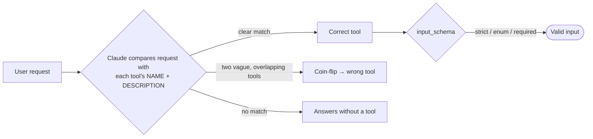
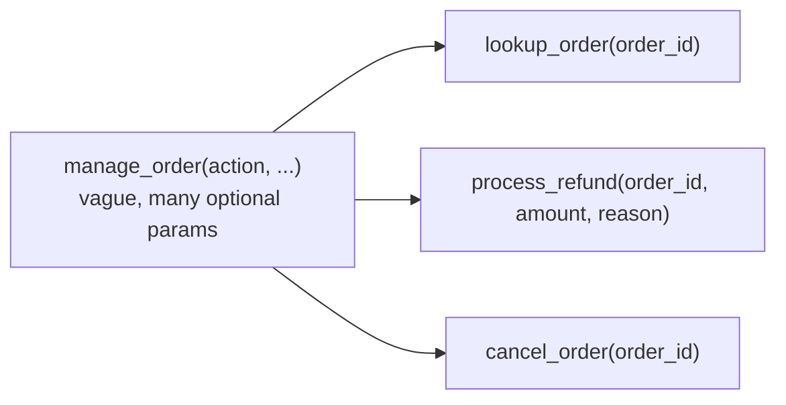

# Chapter 9 — Tool Design Fundamentals
{: .no_toc }

<details open markdown="block">
<summary>Contents</summary>
{: .text-delta }
1. TOC
{:toc}
</details>

---

## 🎯 Exam Snapshot

| Item | Detail |
|:--|:--|
| Domain | D2 Tool Design & MCP Integration (~18%) |
| The exam tests whether you can… | 1. Fix wrong tool choices by improving **descriptions, names and splits** |
| | 2. Design **input schemas** (required fields, enums, formats, `strict`) |
| | 3. Choose the right **`tool_choice`** and keep the tool count small for each agent |

---

## 🧠 Core Concepts

1. A tool definition has three parts: **`name`**, **`description`** and **`input_schema`** (JSON Schema).
2. The **description is the main routing signal**. Claude can't see your code, only this text.
3. A good description answers: **what** the tool does, **when** to use it, **when not** to use it, the **input format** with an example, and **what it returns**.
4. **Overlapping tools** (`get_customer` vs `lookup_order`, each with a one-line description) cause wrong choices. Spell out the **boundary** between them.
5. **Rename** vague tools (`analyze_content` → `extract_web_results`). **Split** catch-all tools into purpose-specific ones, each with a clear input/output contract.
6. **Keyword triggers**: a prompt line like *"always check the customer first"* can make Claude call `get_customer` far too often. Watch for wording that ties a word to a tool by accident.
7. **Schemas prevent bad inputs**: required fields, `enum` for fixed sets, formats or patterns, and `additionalProperties: false`.
8. **`strict: true`** (strict tool use) makes Claude's tool inputs **always match the schema**.
9. **Fewer tools per agent = better choices.** Aim for about 4–5 tools per role. For large catalogs, use **tool search** (deferred loading).

{: .key }
When the wrong tool is called, the first fix is to **improve the tool descriptions**. It costs little and helps the most. Routing layers, classifiers or merging tools come later, if ever.

---

## 🔀 Diagrams

### How Claude selects a tool



### Split a catch-all tool



---

## 📊 Description: Bad vs Good

| | Bad | Good |
|:--|:--|:--|
| `get_customer` | "Gets customer info." | "Find and **verify** a customer by email or phone. Use it **first** whenever the customer's identity is not yet verified. Returns `customer_id` and `verified`. Do **not** use it for order details. Use `lookup_order` for those." |
| `lookup_order` | "Gets order." | "Get one order by order ID (format `ORD-12345`). Returns status, items, total and ship date. Needs a verified `customer_id`. Do **not** use it to search by customer name." |

## 📊 Schema Design Rules

| Rule | Why | Example |
|:--|:--|:--|
| Mark truly needed fields **`required`** | Claude won't leave them out | `"required": ["order_id"]` |
| Use **`enum`** for fixed sets | Stops invented values | `"reason": {"enum": ["damaged","late","wrong_item","other"]}` |
| Add **`other` + a detail field** | Handles unexpected cases | `reason="other"`, `reason_detail="..."` |
| Give **formats and examples** in the field description | Fewer malformed inputs | `"Order ID like ORD-12345"` |
| **`additionalProperties: false`** | No stray fields | – |
| **`strict: true`** on the tool | Inputs are guaranteed to match the schema | – |
| Keep optional fields **optional** | Forcing them leads to invented values | – |

## 📊 `tool_choice`

| Setting | Behaviour | Use when |
|:--|:--|:--|
| `{"type": "auto"}` *(default)* | Claude decides whether to use a tool | Normal agents |
| `{"type": "any"}` | **Must** call *some* tool | You need structured output but there are several possible schemas |
| `{"type": "tool", "name": "x"}` | **Must** call tool `x` | Force a specific first step (for example `extract_metadata`) |
| `{"type": "none"}` | No tools allowed | Final text-only answer |
| `"disable_parallel_tool_use": true` | At most one tool per turn | Steps must run strictly one at a time |

{: .note }
With `any` or forced `tool`, Claude goes **straight to the tool call**, with no explanation text first. Extended thinking works only with `auto` or `none`.

## 📊 Too Many Tools?

| Symptom | Fix |
|:--|:--|
| An agent with 18 tools picks the wrong ones | **Scope** the tools per role (Ch 7). Give each agent only what it needs |
| The catalog really has hundreds of tools | **Tool search**: mark tools `defer_loading: true` and add a tool-search tool. Claude loads only the definitions it finds |
| Two tools do almost the same thing | **Merge** them, or sharpen the boundary in both descriptions |

---

## 💻 Implementation — A Well-Designed Tool

```python
import anthropic
client = anthropic.Anthropic()

process_refund = {
    "name": "process_refund",
    "description": (
        "Issue a refund for ONE order that belongs to a VERIFIED customer. "
        "Use only after get_customer and lookup_order have succeeded. "
        "Do NOT use for exchanges or cancellations. "
        "Returns refund_id and status. Refunds over $500 are rejected; "
        "use escalate_to_human for those."),
    "strict": True,                                   # inputs always match the schema
    "input_schema": {
        "type": "object",
        "properties": {
            "order_id": {"type": "string", "description": "Order ID like ORD-12345"},
            "amount":   {"type": "number", "description": "Refund in USD, > 0"},
            "reason":   {"type": "string",
                         "enum": ["damaged", "late", "wrong_item", "other"]},
            "reason_detail": {"type": "string", "description": "Required if reason=other"},
        },
        "required": ["order_id", "amount", "reason"],
        "additionalProperties": False,
    },
}

resp = client.messages.create(
    model="claude-sonnet-5-5", max_tokens=1024,
    tools=[process_refund],
    tool_choice={"type": "auto"},
    messages=[{"role": "user", "content": "Refund my damaged order ORD-12345, $40"}])
```

1. The description covers **what, when, when not, and the result**, and points to the alternative tool.
2. `enum`, `required` and `additionalProperties: false` block invented or stray values.
3. The $500 limit is *mentioned* here for routing, but it is **enforced in code** (Ch 8).

---

## ⚠️ Exam Traps

| Distractor | Why it's wrong | Correct choice |
|:--|:--|:--|
| The agent mixes up `get_customer` and `lookup_order` → "add a routing classifier" | Overkill. The cause is vague descriptions | **Expand the descriptions** with boundaries and input formats |
| "Add few-shot examples of tool choice" as the *first* fix | Treats the symptom | Fix the descriptions first |
| Give one agent all 18 tools | Selection gets worse | Scope 4–5 tools per role, or use tool search |
| Use `tool_choice: auto` when the output *must* be structured | Claude may answer in text | `any`, or a forced `tool` |
| Make every field `required` "for completeness" | Claude invents values for fields it doesn't know | Required only when truly needed. Optional or nullable otherwise |
| One generic `manage_order` tool with an `action` parameter | Vague routing and contract | Split it into purpose-specific tools |

---

## 🧩 Scenario Mini-Case

**ShopAssist logs:** in many cases a customer asks *"where's my order ORD-88?"* and the agent calls `get_customer` again and again instead of `lookup_order`.

| Check | Finding |
|:--|:--|
| Descriptions | Both are one line long: "Gets customer info" and "Gets order" |
| System prompt | It says "Always check the customer" in bold → a keyword trigger |
| **Fix** | Rewrite both descriptions with when / when-not / input format, and reword the prompt to "verify identity **once** per case" |

---

## 🔁 Quick Recall

| Q | A |
|:--|:--|
| What does Claude use to pick a tool? | Name + description + schema |
| First fix for wrong tool selection? | Better descriptions |
| Force a specific tool? | `tool_choice: {"type":"tool","name":...}` |
| Guarantee schema-valid inputs? | `strict: true` |
| Hundreds of tools? | Tool search with deferred loading |

---

## 🔗 References

1. [Tool use overview — Claude Docs](https://docs.claude.com/en/docs/agents-and-tools/tool-use/overview)
2. [Implement tool use (descriptions, tool_choice)](https://docs.claude.com/en/docs/agents-and-tools/tool-use/implement-tool-use)
3. [Writing effective tools for agents — Anthropic Engineering](https://www.anthropic.com/engineering/writing-tools-for-agents)
4. [Tool search tool — Claude Docs](https://docs.claude.com/en/docs/agents-and-tools/tool-use/tool-search-tool)
