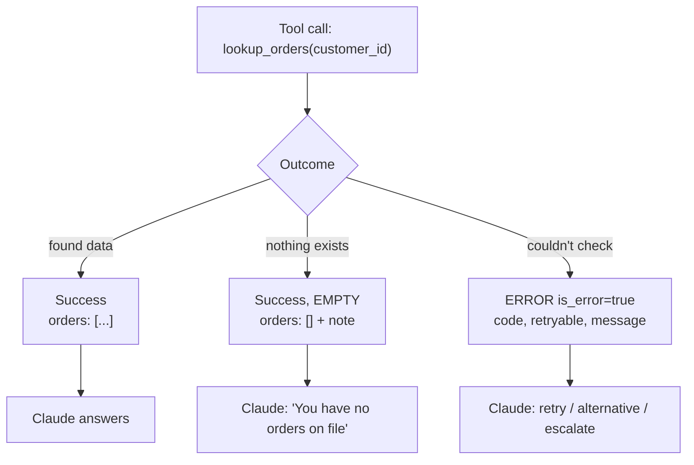
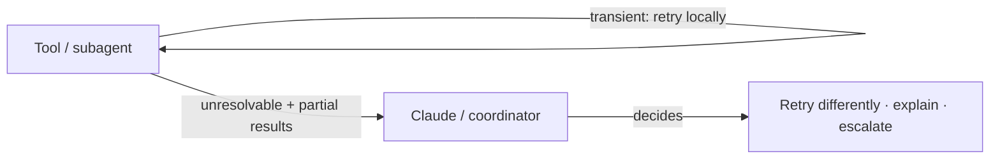

# Chapter 10 — Tool Errors & Tool Results
{: .no_toc }

<details open markdown="block">
<summary>Contents</summary>
{: .text-delta }
1. TOC
{:toc}
</details>

---

## 🎯 Exam Snapshot

| Item | Detail |
|:--|:--|
| Domain | D2 (~18%) |
| The exam tests whether you can… | 1. Return **structured errors** that Claude can act on |
| | 2. Tell a **valid empty result** apart from an **access failure** |
| | 3. Handle **partial success** and **trim** large tool results |

---

## 🧠 Core Concepts

1. A tool error goes back to Claude as a **`tool_result`** with **`is_error: true`** (in MCP: `isError: true`). It is information, not a crash.
2. A **structured error** contains a stable **code**, a **category**, whether it is **retryable**, a clear **message**, the **context** (the input that failed), and a **suggested action**.
3. A generic error like `"Operation failed"` gives Claude nothing to work with. It will guess, loop or give up.
4. **Empty ≠ error.** "No orders found" is a **successful** result with `[]`. A timeout is an **error**. Mixing them up leads to wrong answers.
5. For **business-rule errors** (for example "return window closed"), include a **customer-safe explanation**, so Claude can tell the customer politely and accurately.
6. **Partial success**: return what worked **and** what failed, so Claude can retry only the failures.
7. **Recover locally first**: a subagent or tool retries transient errors itself and passes up only what it **can't resolve**, together with partial results.
8. **Trim results**: return only the fields that matter (5 of 40). Big payloads waste context and push key facts into the "lost in the middle" zone.

---

## 🔀 Diagrams

### Three outcomes of a tool call



### Where errors are handled



---

## 📊 Error Categories

| Category | Example | `retryable` | What Claude should do |
|:--|:--|:--:|:--|
| **Transient** | Timeout, 429, 503 | ✅ | Retry later or use an alternative source |
| **Validation** | Bad order ID format | ✅ after a fix | Correct the input and call again |
| **Business rule** | Return window closed, over the refund limit | ❌ | Explain to the customer, offer options, or escalate |
| **Permission** | Not allowed for this user | ❌ | Don't retry. Explain or escalate |
| **Not found** | Order ID doesn't exist | ❌ | Ask the customer to confirm the ID |

## 📊 Error Message Quality

| Bad | Good |
|:--|:--|
| `"Error"` | `{"code": "RETURN_WINDOW_CLOSED", "category": "business", "retryable": false, "message": "Order ORD-12 delivered 45 days ago; returns allowed within 30 days.", "customer_message": "This order is past the 30-day return window.", "suggested_action": "Offer store credit or escalate_to_human."}` |
| `"Search unavailable"` | `{"code": "TIMEOUT", "category": "transient", "retryable": true, "context": {"query": "..."}, "partial_results": [...]}` |

## 📊 Shaping Tool Results

| Technique | Use when |
|:--|:--|
| Return **only the relevant fields** | The backend returns large objects (40+ fields) |
| **Paginate** or truncate, with a "more available" note | Long lists |
| Return **IDs + summaries**, with a separate detail tool | Search results |
| **Normalize** formats (dates in ISO 8601, consistent status codes) | Mixed backends (often done in a PostToolUse hook, Ch 8) |
| Human-readable names instead of raw UUIDs, where possible | Claude reasons better over meaningful values |

---

## 💻 Implementation — Structured Results & Errors

```python
import json

def tool_error(code, category, message, retryable, **extra) -> dict:
    return {"code": code, "category": category, "message": message,
            "retryable": retryable, **extra}

def lookup_orders(customer_id: str) -> dict:
    try:
        rows = db_find_orders(customer_id, timeout=3)      # your backend
    except TimeoutError:
        return {"is_error": True, "content": tool_error(
            "TIMEOUT", "transient", "Order DB timed out", True,
            context={"customer_id": customer_id})}
    if not rows:                                           # EMPTY is success
        return {"is_error": False,
                "content": {"orders": [], "note": "Customer has no orders."}}
    slim = [{"order_id": r["id"], "status": r["status"],   # trim 40 fields -> 4
             "total": r["total"], "date": r["created"].isoformat()} for r in rows]
    return {"is_error": False, "content": {"orders": slim}}

def to_tool_result(tool_use_id: str, out: dict) -> dict:
    return {"type": "tool_result", "tool_use_id": tool_use_id,
            "content": json.dumps(out["content"]), "is_error": out["is_error"]}
```

1. A timeout is an **error** with a category, a retry flag and context.
2. No orders is a **success** with an empty list and a note.
3. The payload is **trimmed and normalized** before Claude sees it.

---

## ⚠️ Exam Traps

| Distractor | Why it's wrong | Correct choice |
|:--|:--|:--|
| Return `[]` when the search times out | A failure is hidden as "nothing exists" | `is_error: true` with a structured error |
| Return `"Error occurred"` | Claude can't choose a recovery | Code, category, retryable, message, suggested action |
| Raise an exception and stop the agent | No chance to recover | Return the error as a `tool_result` |
| Retry a "return window closed" error | Business rules don't change on a retry | `retryable: false` → explain or escalate |
| Return the full 40-field record "just in case" | Wastes context and buries the key facts | Return only the relevant fields |
| Fail the whole batch if 1 of 10 items fails | Throws away 9 good results | Partial success: succeeded + failed lists |

---

## 🧩 Scenario Mini-Case

**ShopAssist:** a customer asks for a refund. `process_refund` returns `"Error"` and the agent tells the customer *"something went wrong, try again later"*. The real cause was that the 30-day window had passed.

| Step | Fix |
|:--|:--|
| Tool | Return `RETURN_WINDOW_CLOSED`, `category: business`, `retryable: false`, plus a `customer_message` |
| Claude | Explains the policy accurately and offers store credit or escalation |
| Result | No useless retries and no misleading "try later" |

---

## 🔁 Quick Recall

| Q | A |
|:--|:--|
| Flag for an error result in the API? MCP? | `is_error: true` / `isError: true` |
| "No orders found" is an error? | No. It's a valid empty success |
| Fields of a good error? | Code, category, retryable, message, context, suggested action |
| Should business-rule errors be retried? | No |
| Why trim tool results? | To save context and keep the key facts visible |

---

## 🔗 References

1. [Tool use — handling tool results & errors](https://docs.claude.com/en/docs/agents-and-tools/tool-use/implement-tool-use)
2. [Writing effective tools for agents — Anthropic Engineering](https://www.anthropic.com/engineering/writing-tools-for-agents)
3. [MCP spec — Tools (error handling)](https://modelcontextprotocol.io/specification/2025-06-18/server/tools)
