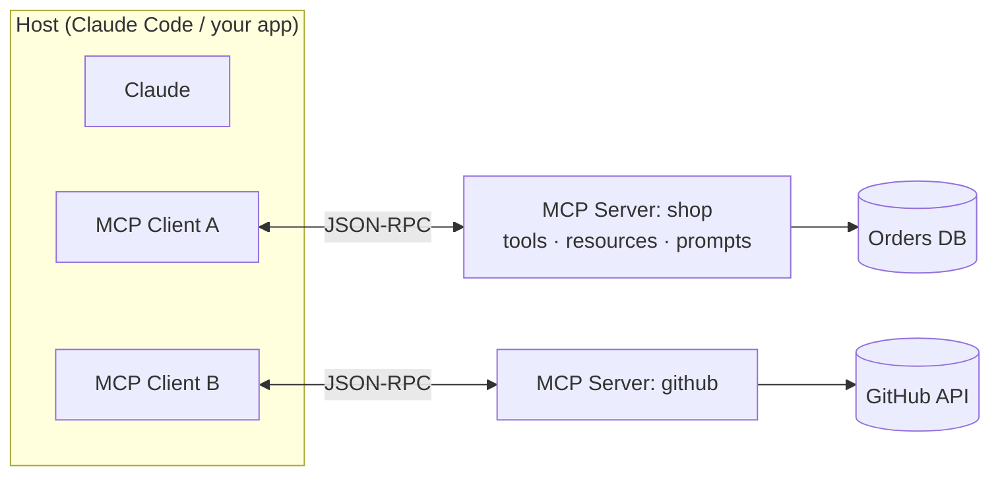
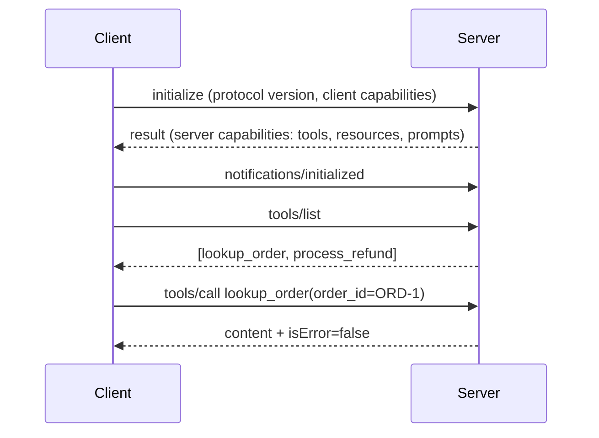

# Chapter 11 — MCP Fundamentals
{: .no_toc }

<details open markdown="block">
<summary>Contents</summary>
{: .text-delta }
1. TOC
{:toc}
</details>

---

## 🎯 Exam Snapshot

| Item | Detail |
|:--|:--|
| Domain | D2 (~18%) |
| The exam tests whether you can… | 1. Explain **host, client and server** roles |
| | 2. Choose the right primitive: **tool, resource or prompt** |
| | 3. Build a small **Python MCP server** and connect a **client** |

---

## 🧠 Core Concepts

1. **MCP (Model Context Protocol)** is an open standard for connecting AI apps to tools and data. You build an integration **once** and any MCP host can use it.
2. **Host**: the AI application (Claude Code, Claude Desktop, your app). It holds the model and the user.
3. **Client**: a connector **inside the host**. There is **one client per server** (a 1:1 connection).
4. **Server**: a program that exposes capabilities (GitHub, a database, your order system).
5. The wire format is **JSON-RPC 2.0**. Each session starts with **`initialize`**, where the two sides **negotiate capabilities** and the protocol version.
6. **Server primitives**:
   - **Tools**: *actions* that the **model** decides to call.
   - **Resources**: *read-only data* identified by a URI, which the **application** chooses to load as context.
   - **Prompts**: *reusable templates* that the **user** picks (for example, as slash commands).
7. **Client primitives**, which the server can ask the client for: **sampling** (an LLM call), **roots** (filesystem boundaries) and **elicitation** (asking the user a question). See Chapter 12.
8. **Resources reduce wasted tool calls.** Exposing a catalog (DB schema, issue list, doc index) as a resource saves the agent from exploring with many tool calls.
9. MCP tool definitions map directly onto Claude API tools: `name`, `description`, `inputSchema` → `input_schema`. That means **Chapter 9's description rules apply unchanged**.

---

## 🔀 Diagrams

### Architecture



### Session lifecycle



---

## 📊 The Three Server Primitives

| Primitive | Who controls it | What it is | Protocol methods | ShopAssist example |
|:--|:--|:--|:--|:--|
| **Tool** | **Model** | An action that can have side effects | `tools/list`, `tools/call` | `process_refund` |
| **Resource** | **Application** | Read-only data identified by a URI | `resources/list`, `resources/read`, templates | `policy://returns`, `orders://{id}` |
| **Prompt** | **User** | A parameterised message template | `prompts/list`, `prompts/get` | `/draft-apology order_id` |

### Which primitive?

| Need | Primitive |
|:--|:--|
| Claude must *do* something or fetch data on demand | **Tool** |
| Provide reference data or context (a schema, a policy, a catalog) | **Resource** |
| Give users a standard, reusable workflow starter | **Prompt** |

---

## 💻 Implementation

### A. Python MCP server (FastMCP, official SDK)

```python
# shop_server.py
from mcp.server.fastmcp import FastMCP

mcp = FastMCP("shop")

@mcp.tool()
def lookup_order(order_id: str) -> dict:
    """Get one order by ID (format ORD-12345). Returns status, items, total.
    Do NOT use to search by customer name."""
    return {"order_id": order_id, "status": "shipped", "total": 40.0}

@mcp.resource("policy://returns")
def returns_policy() -> str:
    """The current returns policy text."""
    return "Returns accepted within 30 days of delivery."

@mcp.resource("orders://{order_id}")
def order_resource(order_id: str) -> str:
    """Read-only order snapshot (resource template)."""
    return f"Order {order_id}: shipped"

@mcp.prompt()
def draft_apology(order_id: str) -> str:
    """Template for a delayed-order apology."""
    return f"Write a short, sincere apology for the delay of order {order_id}."

if __name__ == "__main__":
    mcp.run()                     # default transport: stdio
```

1. The **function signature and type hints** become the `inputSchema`.
2. The **docstring** becomes the description, so write it like a Chapter 9 description.
3. `{order_id}` in the URI makes this a **resource template**.

### B. Python MCP client → Claude tools

```python
import asyncio
from mcp import ClientSession, StdioServerParameters
from mcp.client.stdio import stdio_client

params = StdioServerParameters(command="python", args=["shop_server.py"])

async def main():
    async with stdio_client(params) as (read, write):
        async with ClientSession(read, write) as session:
            await session.initialize()                    # capability handshake
            tools = (await session.list_tools()).tools
            claude_tools = [{"name": t.name, "description": t.description,
                             "input_schema": t.inputSchema} for t in tools]
            result = await session.call_tool("lookup_order", {"order_id": "ORD-1"})
            print(claude_tools, result.content, result.isError)

asyncio.run(main())
```

1. `initialize()` must run first.
2. MCP tools turn into Claude API tools field by field.
3. In the agentic loop (Ch 5), `tool_use` → `session.call_tool` → `tool_result`.

{: .tip }
In **Claude Code** you don't write a client. Register the server (`claude mcp add …` or `.mcp.json`) and its tools appear as `mcp__<server>__<tool>`.

---

## ⚠️ Exam Traps

| Distractor | Why it's wrong | Correct choice |
|:--|:--|:--|
| "One MCP client connects to many servers" | Clients and servers are 1:1 | The **host** runs one client per server |
| Expose a static policy document as a tool | It is read-only context, not an action | A **resource** |
| "Resources are called by the model like tools" | Resources are **application-controlled** | Tools = model, resources = app, prompts = user |
| The agent makes 20 exploratory calls to learn the DB layout | Wasted turns | Expose the schema as a **resource** |
| Skip `initialize` | No capability negotiation, so the session is invalid | Always initialize first |
| Thin docstrings on MCP tools | Claude prefers built-in tools (for example Grep) over a vague MCP tool | Write rich descriptions (Ch 9 rules) |

---

## 🧩 Scenario Mini-Case

**Dev team:** the agent keeps using `Grep` across the repo instead of the team's `search_issues` MCP tool, which is more capable.

| Check | Finding |
|:--|:--|
| MCP tool description | "Searches issues." (3 words) |
| **Fix** | Describe what it finds, when to prefer it over Grep, the input syntax and the output fields |
| Bonus | Expose an issue **index as a resource** so the agent starts with context |

---

## 🔁 Quick Recall

| Q | A |
|:--|:--|
| The 3 roles? | Host, client, server |
| Client:server ratio? | 1:1 |
| Tool / resource / prompt are controlled by? | Model / application / user |
| Wire protocol? | JSON-RPC 2.0 |
| The first call in a session? | `initialize` |

---

## 🔗 References

1. [MCP architecture overview](https://modelcontextprotocol.io/docs/learn/architecture)
2. [MCP server concepts — tools, resources, prompts](https://modelcontextprotocol.io/docs/learn/server-concepts)
3. [MCP Python SDK (FastMCP)](https://github.com/modelcontextprotocol/python-sdk)
4. [Build an MCP server — quickstart](https://modelcontextprotocol.io/quickstart/server)
