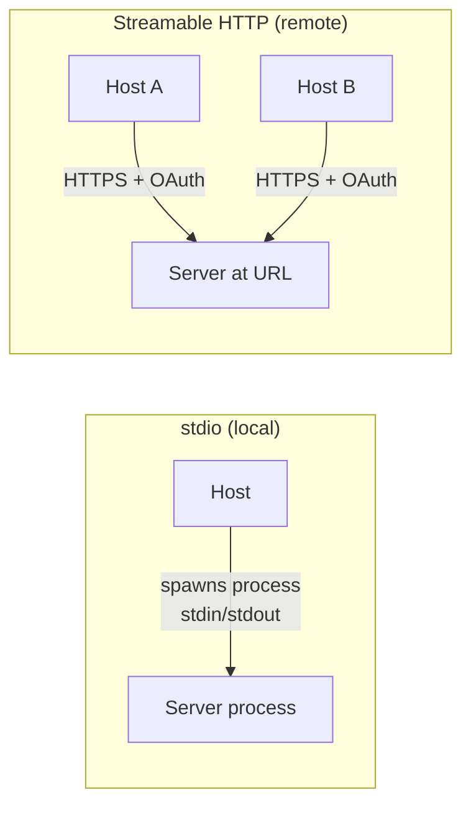
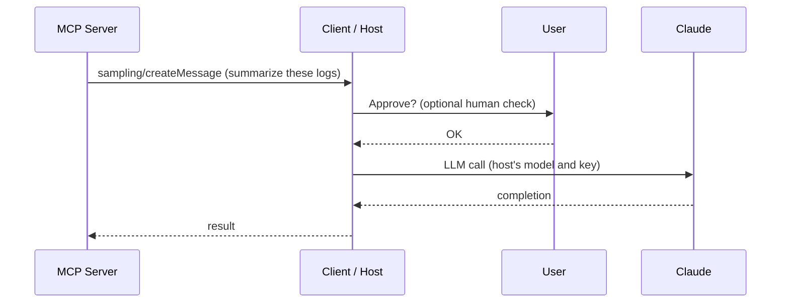
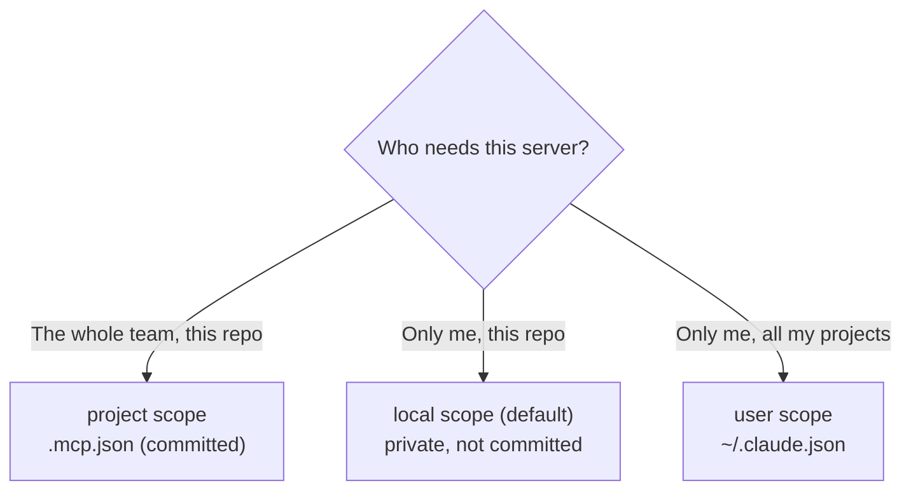

# Chapter 12 — MCP in Production
{: .no_toc }

<details open markdown="block">
<summary>Contents</summary>
{: .text-delta }
1. TOC
{:toc}
</details>

---

## 🎯 Exam Snapshot

| Item | Detail |
|:--|:--|
| Domain | D2 (~18%). It also appears in the **developer productivity** and **Claude Code** scenarios |
| The exam tests whether you can… | 1. Choose **stdio** or **Streamable HTTP** |
| | 2. Use **sampling, roots and notifications** correctly |
| | 3. **Share MCP servers safely** in Claude Code (scopes, `.mcp.json`, secrets) |
| | 4. Choose **built-in, community or custom** tools |

---

## 🧠 Core Concepts

1. **stdio transport**: the host starts the server as a **local subprocess** and they talk over stdin/stdout. One client, no network. Credentials come from **environment variables**.
2. **Streamable HTTP transport**: a **remote** server at a URL. It uses HTTP POST with optional streaming, serves **many clients**, and authenticates with **OAuth**. The older HTTP+SSE transport is deprecated.
3. **Sampling**: the *server* asks the *client* to run an LLM call. The server needs **no API key of its own**, and the host stays in control and can ask the user to approve.
4. **Roots**: the client tells the server **which directories or URIs it may work in**. This sets a boundary.
5. **Elicitation**: the server asks the **user** for missing input, through the client.
6. **Notifications**: `list_changed` (the tools or resources have changed), **progress** for long operations, logging, and cancellation.
7. **Least privilege**: give each server the narrowest scope it needs. Prefer read-only tools. Use scoped tokens. Validate every input on the server.
8. **Tool annotations** (`readOnlyHint`, `destructiveHint`…) are **hints, not security**. Enforce the rules in the server.
9. **Prefer existing community servers** (GitHub, Jira…) for standard integrations. Write a **custom** server only for team-specific workflows.

---

## 🔀 Diagrams

### Transports



### Sampling: the server borrows the host's model



### Claude Code MCP scopes



---

## 📊 stdio vs Streamable HTTP

| | stdio | Streamable HTTP |
|:--|:--|:--|
| Location | Same machine, as a subprocess | Remote, at a URL |
| Clients | One | Many |
| Auth | Environment variables / local trust | **OAuth** / tokens over HTTPS |
| Deploy | Ships with the developer's setup | A central service you can version and monitor |
| Best for | Local files, CLIs, dev tools | Shared company services, SaaS |

## 📊 Client Features the Server Can Use

| Feature | Direction | Purpose |
|:--|:--|:--|
| **Sampling** | Server → client | Server-side LLM reasoning without its own API key |
| **Roots** | Client → server | Limits which files or URIs the server works in |
| **Elicitation** | Server → user (via the client) | Ask for missing or confirming input |
| **Progress** | Server → client | Status updates on long tasks |
| **list_changed** | Server → client | "Re-fetch my tools or resources" |

## 📊 Production Checklist

| Area | Practice |
|:--|:--|
| Secrets | **Never commit tokens.** Use `${ENV_VAR}` expansion in `.mcp.json` |
| Access | Least privilege: read-only by default, scoped tokens, per-agent tool scoping |
| Input | Validate and sanitize on the server. Treat model inputs as untrusted |
| Trust | Install only servers you trust. Tool descriptions and results can carry **prompt injection** |
| Versioning | Keep tool changes backward compatible. Send `list_changed` when they change |
| Reliability | Timeouts, structured errors (Ch 10), health checks, logging |

## 📊 Built-in vs Community vs Custom

| Option | Choose when | Examples |
|:--|:--|:--|
| **Built-in tools** | Generic file, shell or web work | Claude Code: `Read`, `Edit`, `Grep`, `Glob`, `Bash`, `WebFetch`, `WebSearch` |
| **Community MCP server** | A **standard** integration that is already maintained | GitHub, Jira, Slack, Postgres |
| **Custom MCP server** | **Team-specific** systems and workflows | The internal order system, the deploy pipeline |

---

## 💻 Implementation

### A. Team-shared server in `.mcp.json` (committed, no secrets)

```json
{
  "mcpServers": {
    "github": {
      "type": "http",
      "url": "https://api.githubcopilot.com/mcp/",
      "headers": { "Authorization": "Bearer ${GITHUB_TOKEN}" }
    },
    "shop": {
      "command": "python",
      "args": ["tools/shop_server.py"],
      "env": { "SHOP_DB_URL": "${SHOP_DB_URL}" }
    }
  }
}
```

### B. CLI equivalents

```bash
claude mcp add --transport http --scope project github https://api.githubcopilot.com/mcp/
claude mcp add --scope user my-notes -- python ~/tools/notes_server.py   # personal
claude mcp list
```

### C. Serving the Chapter 11 server remotely

```python
mcp.run(transport="streamable-http")      # instead of the default stdio
```

1. `${VAR}` keeps secrets **out of git**. Each developer sets their own environment variables.
2. **Project scope** means the whole team gets the same servers. Claude Code asks for approval before using project servers.
3. The same server code can run over **either transport**.

---

## ⚠️ Exam Traps

| Distractor | Why it's wrong | Correct choice |
|:--|:--|:--|
| Commit the API token in `.mcp.json` | A secret leaks into git | `${ENV_VAR}` expansion |
| Put the team's shared server in user scope | Teammates don't get it | **Project scope** (`.mcp.json`) |
| Put a personal experimental server in `.mcp.json` | It forces the server on the team | Local or user scope |
| stdio for a service many users share | stdio is local and single-client | Streamable HTTP + OAuth |
| Give the server its own Claude API key for summaries | An extra secret and less host control | **Sampling** through the client |
| Rely on `readOnlyHint` for security | Annotations are hints only | Enforce in the server, with scoped credentials |
| Build a custom GitHub MCP server | Reinvents something already maintained | Use the **community / official** server |

---

## 🧩 Scenario Mini-Case

**Developer productivity:** five developers each set up the Jira MCP server by hand. Configurations drift, and one token was committed.

| Step | Decision |
|:--|:--|
| 1 | Use the maintained **Jira community server** rather than a custom one |
| 2 | Define it once in the repo's **`.mcp.json`** (project scope) |
| 3 | Pass the token as **`${JIRA_TOKEN}`** and rotate the leaked one |
| 4 | Use a read-only scoped token unless writes are needed |

---

## 🔁 Quick Recall

| Q | A |
|:--|:--|
| Local subprocess transport? | stdio |
| Remote, multi-client transport? | Streamable HTTP (with OAuth) |
| The server needs an LLM call without its own key? | Sampling |
| Limit which directories the server may touch? | Roots |
| Team-shared MCP configuration file? | `.mcp.json` (project scope) |
| How do you keep secrets out of it? | `${ENV_VAR}` expansion |

---

## 🔗 References

1. [MCP transports — spec](https://modelcontextprotocol.io/specification/2025-06-18/basic/transports)
2. [MCP client concepts — sampling, roots, elicitation](https://modelcontextprotocol.io/docs/learn/client-concepts)
3. [MCP security best practices](https://modelcontextprotocol.io/specification/2025-06-18/basic/security_best_practices)
4. [Claude Code — MCP (scopes, .mcp.json)](https://code.claude.com/docs/en/mcp)
