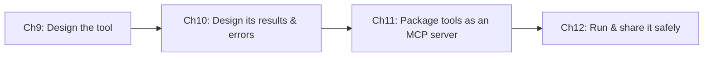

# Part C — Tool Design & MCP Integration
{: .no_toc }

**Domain 2 · ~18% of the exam**
{: .fs-5 }

| Ch | Title | Pages | You must be able to… |
|:--|:--|:--|:--|
| 9 | [Tool Design Fundamentals](09-tool-design.html) | 4 | Write tool descriptions and schemas that make Claude pick the right tool with valid inputs |
| 10 | [Tool Errors & Tool Results](10-tool-errors-results.html) | 3 | Return structured errors, tell empty results apart from failures, and trim payloads |
| 11 | [MCP Fundamentals](11-mcp-fundamentals.html) | 4 | Explain host, client and server, the 3 primitives, and build a Python server and client |
| 12 | [MCP in Production](12-mcp-production.html) | 3 | Choose a transport, scope access, and share servers safely in Claude Code |

{: .key }
Claude chooses a tool **only from its name, description and schema**. Most "the wrong tool was called" questions are answered by **better descriptions**.
