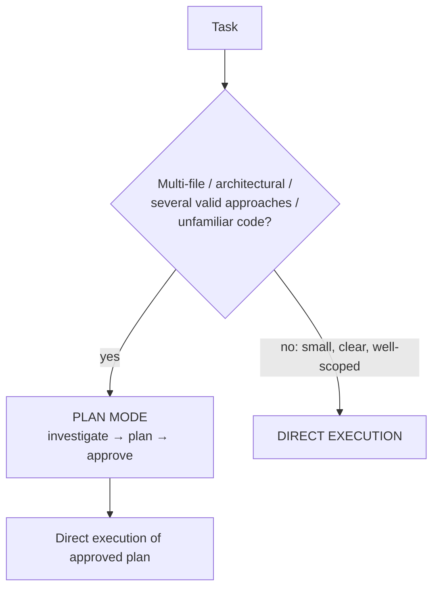
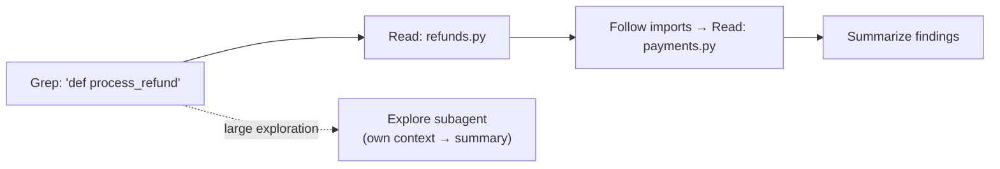

# Chapter 13 — Claude Code Architecture, Built-in Tools & Permissions
{: .no_toc }

<details open markdown="block">
<summary>Contents</summary>
{: .text-delta }
1. TOC
{:toc}
</details>

---

## 🎯 Exam Snapshot

| Item | Detail |
|:--|:--|
| Domain | D3 Claude Code Configuration & Workflows (~20%) |
| The exam tests whether you can… | 1. Pick the right **built-in tool** (Grep vs Glob, Edit vs Write) |
| | 2. Choose **plan mode** or **direct execution** |
| | 3. Configure **permission modes and rules** |
| | 4. Explore a codebase **without flooding the context** (the Explore subagent) |

---

## 🧠 Core Concepts

1. **Claude Code** is an agentic coding tool for the terminal, IDE, desktop and web. Inside, it runs **the same agentic loop** (Ch 5) with a built-in toolset.
2. **Context sources**: the system prompt, **CLAUDE.md** files (Ch 14), your messages, `@file` mentions, and tool results.
3. **Grep** searches file **contents** (regex). **Glob** finds files by **name or path pattern**.
4. **Edit** makes targeted changes by matching **unique** text. If the match isn't unique, use **Read + Write** (or a larger, unique anchor).
5. **Explore step by step**: Grep for entry points → Read those files → follow the imports. Don't read the whole repo up front.
6. **Explore subagent**: a read-only helper that does verbose discovery in **its own context** and returns a **summary**, which keeps the main context clean.
7. **Plan mode**: read-only. Claude investigates and proposes a plan, and **nothing is changed** until you approve.
8. **Permission modes** control how much Claude does without asking. **Permission rules** (allow, ask, deny) fine-tune individual tools, and **deny always wins**.

---

## 🔀 Diagrams

### Plan mode vs direct execution



### Exploring a codebase incrementally



---

## 📊 Built-in Tools

| Tool | Use for | Exam example |
|:--|:--|:--|
| **Grep** | Searching **contents** with a regex | "Find every caller of `process_refund`", "find this error message" |
| **Glob** | Finding files by **path pattern** | "All `**/*.test.tsx` files" |
| **Read** | Viewing a file | Following imports after Grep |
| **Edit** | A targeted change through a **unique** text match | Fix one line |
| **Write** | Creating or overwriting a whole file | A new file, or the fallback when Edit's match isn't unique |
| **Bash** | Running commands (tests, git, builds) | `pytest -x` |
| **WebFetch / WebSearch** | Web docs and research | Reading library docs |
| **Task / subagents** | Delegating in an isolated context | Explore subagent |

## 📊 Plan Mode vs Direct Execution

| Plan mode ✅ | Direct execution ✅ |
|:--|:--|
| Restructuring a monolith into microservices | A single-file bug fix with a clear stack trace |
| A library migration touching 45+ files | Adding one validation check |
| Several valid designs to compare | A well-defined, small change |
| Unfamiliar codebase | The pattern is already clear |

## 📊 Permission Modes

| Mode | Behaviour | Use when |
|:--|:--|:--|
| `default` | Asks before edits and commands | Normal interactive work |
| `acceptEdits` | Accepts file edits automatically, still asks for risky commands | Trusted, iterative editing |
| `plan` | **Read-only**: analyses and proposes | Complex or unfamiliar changes |
| `bypassPermissions` | Never asks | **Only** in isolated sandboxes or containers |

{: .tip }
Press **Shift+Tab** to cycle modes interactively. Use `--permission-mode` on the CLI.

## 📊 Settings Precedence (highest first)

| # | Source | Shared? |
|:--|:--|:--|
| 1 | Enterprise **managed** policy | Org-wide, can't be overridden |
| 2 | Command-line arguments | That session |
| 3 | `.claude/settings.local.json` | Personal, gitignored |
| 4 | `.claude/settings.json` | **Team**, committed |
| 5 | `~/.claude/settings.json` | Personal, all projects |

---

## 💻 Implementation — Team Permission Rules

`.claude/settings.json` (committed):

```json
{
  "permissions": {
    "allow": ["Bash(pytest:*)", "Bash(git diff:*)", "Read(src/**)"],
    "ask":   ["Bash(git push:*)"],
    "deny":  ["Read(./.env)", "Read(./secrets/**)", "Bash(rm -rf:*)"]
  }
}
```

1. **allow** removes prompts for safe, frequent commands.
2. **deny** blocks secrets and destructive commands, and it **beats** any allow.
3. Because it's committed, the **whole team** gets the same guard-rails.

---

## ⚠️ Exam Traps

| Distractor | Why it's wrong | Correct choice |
|:--|:--|:--|
| Use Glob to find all callers of a function | Glob matches **names**, not contents | **Grep** |
| Use Grep to list all test files | Grep searches content | **Glob** `**/*.test.*` |
| Edit fails because the match isn't unique → "keep retrying Edit" | It will fail the same way | **Read + Write**, or a unique anchor |
| Direct execution for a 45-file migration | No overview, so the work gets redone | **Plan mode** first |
| Plan mode for a one-line fix | Unnecessary overhead | Direct execution |
| Read every file up front to "understand the repo" | Fills the context | Grep → Read incrementally, or the Explore subagent |
| `bypassPermissions` on a developer laptop | No safety prompts | Sandboxes or containers only |

---

## 🧩 Scenario Mini-Case

**Code generation:** *"Migrate the whole service from requests to httpx (about 60 call sites)."*

| Step | Decision |
|:--|:--|
| 1 | **Plan mode**: Grep for `requests.` and use the Explore subagent to map the usage patterns |
| 2 | Review and approve the plan (order of changes, test strategy) |
| 3 | **Direct execution** in batches, with `pytest` after each batch |

---

## 🔁 Quick Recall

| Q | A |
|:--|:--|
| Search file contents? File names? | Grep / Glob |
| Edit's match isn't unique? | Read + Write |
| Read-only planning mode? | `plan` |
| Rule that beats allow? | deny |
| Keep verbose exploration out of the main context? | Explore subagent |

---

## 🔗 References

1. [Claude Code overview](https://code.claude.com/docs/en/overview)
2. [Settings & permissions](https://code.claude.com/docs/en/settings)
3. [IAM / permission modes](https://code.claude.com/docs/en/iam)
4. [Common workflows (plan mode, exploring code)](https://code.claude.com/docs/en/common-workflows)
