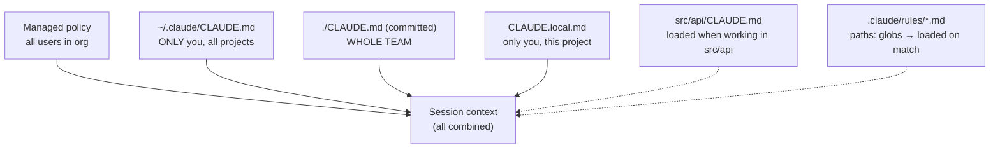

# Chapter 14 — CLAUDE.md, Rules & Memory
{: .no_toc }

<details open markdown="block">
<summary>Contents</summary>
{: .text-delta }
1. TOC
{:toc}
</details>

---

## 🎯 Exam Snapshot

| Item | Detail |
|:--|:--|
| Domain | D3 (~20%). Very frequently tested |
| The exam tests whether you can… | 1. Put an instruction at the **right CLAUDE.md level** |
| | 2. Split a large CLAUDE.md with **`@import`** and **`.claude/rules/`** |
| | 3. Use **path-scoped rules** (globs) for conventions spread across folders |
| | 4. Diagnose "Claude ignores our standards" with **`/memory`** |

---

## 🧠 Core Concepts

1. **CLAUDE.md** is **memory**: instructions that are **loaded automatically** into every session.
2. **Levels**:
   - **Managed** (org policy): org-wide.
   - **User** `~/.claude/CLAUDE.md`: you, in every project, **not shared**.
   - **Project** `./CLAUDE.md` or `./.claude/CLAUDE.md`: **committed**, so the whole team gets it.
   - **Local** `CLAUDE.local.md`: you, in this project, gitignored.
3. **Loading**: CLAUDE.md files from the working directory **up to the root** load at start. **Subdirectory** CLAUDE.md files load **when Claude works in that subtree**.
4. The levels are **combined, not replaced**. Avoid contradictions between them. Specific (closer) files refine general ones.
5. **`@path/to/file`** inside CLAUDE.md **imports** another file. Imports can nest a few levels deep.
6. **`.claude/rules/*.md`**: modular rule files loaded automatically. Add **`paths:`** frontmatter (globs) so a rule loads **only for matching files**.
7. **Path rules vs a subdirectory CLAUDE.md**: use **globs** when the files are **spread across many folders** (for example all `*.test.tsx`), and a **directory CLAUDE.md** when the convention belongs to **one folder**.
8. **`/memory`** shows **which memory files are loaded** and opens them for editing. It is the first thing to check when different team members see different behaviour.
9. **Write instructions Claude follows**: specific (*"use 2-space indent"*, not *"format nicely"*), short bullets, the exact commands, and **concise** (everything uses up context).

---

## 🔀 Diagrams

### Who gets what



### Example layout

```text
repo/
├── CLAUDE.md                 # team: build/test commands, @imports
├── CLAUDE.local.md           # me: personal sandbox URLs (gitignored)
├── .claude/
│   └── rules/
│       ├── testing.md        # paths: ["**/*.test.tsx", "**/test_*.py"]
│       └── api-style.md      # paths: ["src/api/**"]
├── docs/standards/
│   └── security.md           # pulled in via @docs/standards/security.md
└── packages/payments/
    └── CLAUDE.md             # payments-only conventions
```

---

## 📊 Where Should This Instruction Go?

| Instruction | Location |
|:--|:--|
| Team build and test commands, architecture notes | **Project** `CLAUDE.md` |
| My personal editor or shell preferences | **User** `~/.claude/CLAUDE.md` |
| My local DB URL for this repo | `CLAUDE.local.md` |
| Testing conventions for test files **across the repo** | `.claude/rules/testing.md` with `paths:` glob |
| Conventions for **one** package or folder | That folder's `CLAUDE.md` |
| A large shared standard (security, style) | A separate file + **`@import`** |
| Company-wide mandatory policy | **Managed** policy |
| A step-by-step workflow used *sometimes* | A **skill** (Ch 15), not CLAUDE.md |

## 📊 Writing Effective Instructions

| ❌ Vague | ✅ Specific |
|:--|:--|
| "Write good tests" | "Use pytest. One `test_*.py` per module. Use the fixtures in `tests/conftest.py`." |
| "Follow our style" | "Format with `ruff format`. Max line 100. Type hints on public functions." |
| "Be careful with the DB" | "Never edit `migrations/` by hand. Run `make migrate-new`." |

---

## 💻 Implementation

### Project `CLAUDE.md` with imports

```markdown
# Project: ShopAssist backend

## Commands
- Test: `pytest -x`   ·   Single test: `pytest tests/test_refunds.py::test_limit`
- Lint: `ruff check . && ruff format --check .`

## Architecture
- `src/api` = FastAPI routes; `src/domain` = business rules (no I/O)

## Standards
@docs/standards/security.md
@docs/standards/python-style.md
```

### Path-scoped rule — `.claude/rules/testing.md`

```markdown
---
paths:
  - "**/test_*.py"
  - "tests/**"
---
# Testing rules
- Use pytest fixtures from tests/conftest.py; never hit the real payment API.
- Each bug fix needs a regression test named test_<bug_id>_*.
```

1. The project CLAUDE.md stays **short**. The details live in imported files.
2. The testing rule loads **only** when Claude touches matching test files, which saves context everywhere else.

---

## ⚠️ Exam Traps

| Distractor | Why it's wrong | Correct choice |
|:--|:--|:--|
| A new teammate doesn't get the standards, which were in the lead's `~/.claude/CLAUDE.md` | The user level is personal and not shared | Move them to the **project** CLAUDE.md |
| Test conventions are copied into 30 subdirectory CLAUDE.md files | Duplication and drift | One **`.claude/rules`** file with a `paths:` glob |
| A 2,000-line CLAUDE.md | Context bloat and diluted attention | Split it with `@import` and rules files |
| "Claude ignores our rules" → rewrite the prompt | You haven't checked what's loaded | Run **`/memory`** first |
| Put a rarely used release workflow in CLAUDE.md | It loads every session | Make it a **skill** |
| Put personal URLs in the committed CLAUDE.md | Pushes personal configuration on the team | `CLAUDE.local.md` or the user level |

---

## 🧩 Scenario Mini-Case

**Team setup:** on one developer's machine Claude follows the API naming rules. On a teammate's machine it doesn't.

| Step | Finding / Fix |
|:--|:--|
| Diagnose | `/memory` on both machines → the rules are only in developer A's `~/.claude/CLAUDE.md` |
| Fix | Move them to `.claude/rules/api-style.md` with `paths: ["src/api/**"]` and commit |
| Result | Same behaviour for everyone, loaded only for API files |

---

## 🔁 Quick Recall

| Q | A |
|:--|:--|
| Team-shared memory file? | Project `CLAUDE.md` (committed) |
| Personal memory for all projects? | `~/.claude/CLAUDE.md` |
| Conventions for files spread across many folders? | `.claude/rules/` + `paths:` globs |
| Pull another file into CLAUDE.md? | `@path/to/file` |
| See which memory files are loaded? | `/memory` |

---

## 🔗 References

1. [Manage Claude's memory (CLAUDE.md, imports, rules)](https://code.claude.com/docs/en/memory)
2. [Settings](https://code.claude.com/docs/en/settings)
3. [Claude Code best practices — Anthropic Engineering](https://www.anthropic.com/engineering/claude-code-best-practices)
