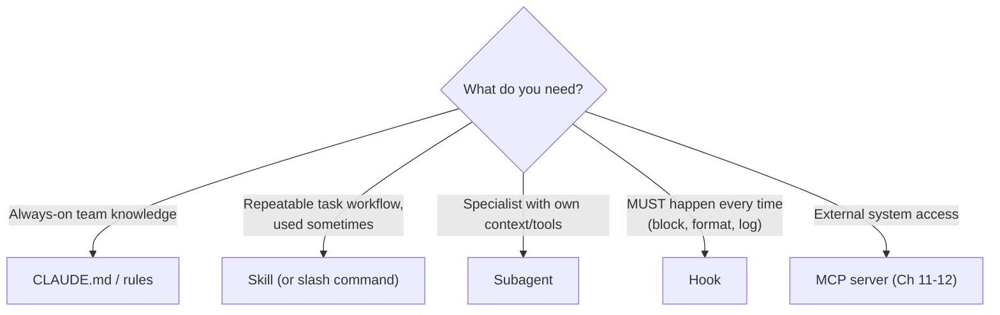
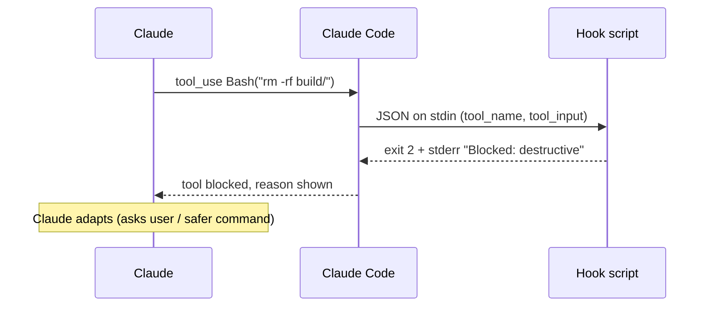

# Chapter 15 — Commands, Skills, Subagents & Hooks
{: .no_toc }

<details open markdown="block">
<summary>Contents</summary>
{: .text-delta }
1. TOC
{:toc}
</details>

---

## 🎯 Exam Snapshot

| Item | Detail |
|:--|:--|
| Domain | D3 (~20%) |
| The exam tests whether you can… | 1. Know **where** commands, skills, subagents and hooks live (project vs user) |
| | 2. Configure **skill frontmatter** (`description`, `allowed-tools`, `context: fork`…) |
| | 3. Choose **CLAUDE.md vs skill vs subagent vs hook** |

---

## 🧠 Core Concepts

1. **Slash commands**: saved prompts you run as `/name`. They live in `.claude/commands/` (project) or `~/.claude/commands/` (personal) and take arguments through **`$ARGUMENTS`**.
2. **Skills**: a folder containing **`SKILL.md`** (frontmatter + instructions) and optional scripts or reference files. Skills can also be run as `/name`.
3. **Progressive disclosure**: only a skill's **name + description** are loaded at first. The full body loads **only when it is used**. This makes skills cheap to have available.
4. **`description`** decides when Claude **invokes a skill automatically**, so write it like a tool description (Ch 9).
5. **`context: fork`** runs the skill in an **isolated subagent context**, so verbose work doesn't fill the main conversation.
6. **`allowed-tools`** limits the tools the skill may use. **`disable-model-invocation: true`** means only the user can trigger it.
7. **Subagents** (`.claude/agents/*.md`): specialists with their **own system prompt, tools and model**, running in a **separate context**. Built-in ones include **Explore** and **Plan**.
8. **Hooks** (in `settings.json`): **shell commands that run deterministically** at lifecycle events. For `PreToolUse`, **exit code 2 blocks** the tool call and stderr goes back to Claude.
9. **Plugins** bundle commands, skills, agents, hooks and MCP servers so they can be shared and installed.

---

## 🔀 Diagrams

### Which mechanism?



### Hook flow (PreToolUse)



---

## 📊 Where Things Live

| Item | Project (shared via git) | Personal (all projects) |
|:--|:--|:--|
| Slash command | `.claude/commands/<name>.md` | `~/.claude/commands/<name>.md` |
| Skill | `.claude/skills/<name>/SKILL.md` | `~/.claude/skills/<name>/SKILL.md` |
| Subagent | `.claude/agents/<name>.md` | `~/.claude/agents/<name>.md` |
| Hooks and permissions | `.claude/settings.json` | `~/.claude/settings.json` |
| MCP servers | `.mcp.json` | user scope (`~/.claude.json`) |

## 📊 Skill Frontmatter

| Field | Purpose |
|:--|:--|
| `name` | The skill's ID and `/name` |
| `description` | **When to use it.** Drives automatic invocation |
| `allowed-tools` | Restricts which tools the skill can use |
| `context: fork` | Runs in an isolated subagent context |
| `argument-hint` | Shows the expected arguments (for example `[pr-number]`) |
| `disable-model-invocation` | `true` = only the user can run it |
| `model` | Overrides the model for this skill |

## 📊 Skill vs Subagent vs Hook vs CLAUDE.md

| | CLAUDE.md / rules | Skill | Subagent | Hook |
|:--|:--|:--|:--|:--|
| Loaded | Always (or on a path match) | On demand | When delegated | On an event |
| Nature | Guidance | Guidance + workflow | Separate worker | **Deterministic code** |
| Context | Main | Main (or fork) | **Own** | None (shell) |
| Guaranteed? | No | No | No | **Yes** |
| Example | "Use pytest" | `/release-notes` | `security-reviewer` | Block `rm -rf`, auto-format |

## 📊 Hook Exit Codes (command hooks)

| Exit code | Effect |
|:--|:--|
| `0` | Success. Continue |
| `2` | **Block**. Stderr is fed back to Claude (PreToolUse blocks the call) |
| Other | A non-blocking error, shown to the user |

---

## 💻 Implementation

### A. Skill — `.claude/skills/review-pr/SKILL.md`

```markdown
---
name: review-pr
description: Review a pull request diff for bugs, security and test gaps. Use when the user asks to review a PR or a diff.
argument-hint: "[pr-number]"
allowed-tools: Read, Grep, Glob, Bash(gh pr diff:*)
context: fork
---
1. Run `gh pr diff $ARGUMENTS`.
2. Review each changed file separately, then check cross-file effects.
3. Report only: file, line, severity (blocker|major|minor), issue, fix.
```

### B. Subagent — `.claude/agents/security-reviewer.md`

```markdown
---
name: security-reviewer
description: Security specialist. Use after changes to auth, payments or input handling.
tools: Read, Grep, Glob
model: sonnet
---
You review code ONLY for security issues (injection, authz, secrets).
Return a list of findings with file:line and a fix. Never edit files.
```

### C. Hooks — `.claude/settings.json` + a Python hook script

```json
{
  "hooks": {
    "PreToolUse": [
      { "matcher": "Bash",
        "hooks": [{ "type": "command", "command": "python3 .claude/hooks/block_danger.py" }] }
    ],
    "PostToolUse": [
      { "matcher": "Edit|Write",
        "hooks": [{ "type": "command", "command": "python3 .claude/hooks/format.py" }] }
    ]
  }
}
```

```python
# .claude/hooks/block_danger.py
import json, sys

data = json.load(sys.stdin)                       # hook input arrives on stdin
cmd = data.get("tool_input", {}).get("command", "")
if "rm -rf" in cmd or "drop table" in cmd.lower():
    print("Blocked: destructive command. Ask the user first.", file=sys.stderr)
    sys.exit(2)                                   # 2 = block, stderr -> Claude
sys.exit(0)
```

```python
# .claude/hooks/format.py
import json, subprocess, sys

path = json.load(sys.stdin).get("tool_input", {}).get("file_path", "")
if path.endswith(".py"):
    subprocess.run(["ruff", "format", path], check=False)   # always formatted
```

1. The skill is **on demand**, runs in a **forked context**, and has **restricted tools**.
2. The subagent is **read-only by design** (no Edit or Write in `tools`).
3. The hooks are **guarantees**: dangerous commands are always blocked, and edited files are always formatted.

---

## ⚠️ Exam Traps

| Distractor | Why it's wrong | Correct choice |
|:--|:--|:--|
| "Always run the formatter" written in CLAUDE.md | Guidance can be skipped | A **PostToolUse hook** |
| A personal command in `.claude/commands/` | It is shared with the whole team through git | `~/.claude/commands/` |
| A team skill in `~/.claude/skills/` | Teammates don't get it | `.claude/skills/` (committed) |
| A long release checklist in CLAUDE.md | Loaded every session, wasting context | A **skill** |
| A skill that floods the conversation with logs | Main context bloat | `context: fork` |
| The skill never triggers automatically | Vague `description` | Describe **what + when to use** |
| A reviewer subagent that is given Edit/Write | Too much privilege | Give only the read tools it needs |

---

## 🧩 Scenario Mini-Case

**Developer productivity:** the team wants (a) a standard `/release-notes` workflow, (b) a guarantee that secrets are never read, and (c) a deep security review on demand.

| Need | Mechanism | Location |
|:--|:--|:--|
| (a) | **Skill** `release-notes` | `.claude/skills/` |
| (b) | **Deny rule** `Read(./.env)` + **PreToolUse hook** | `.claude/settings.json` |
| (c) | **Subagent** `security-reviewer` (read-only tools) | `.claude/agents/` |

---

## 🔁 Quick Recall

| Q | A |
|:--|:--|
| Skill file name? | `SKILL.md` inside `.claude/skills/<name>/` |
| Isolate a skill's context? | `context: fork` |
| Limit a skill's tools? | `allowed-tools` |
| A hook exit code that blocks? | `2` |
| Guidance vs guarantee? | CLAUDE.md or skill vs hook |

---

## 🔗 References

1. [Skills — Claude Code](https://code.claude.com/docs/en/skills)
2. [Slash commands](https://code.claude.com/docs/en/slash-commands)
3. [Subagents](https://code.claude.com/docs/en/sub-agents)
4. [Hooks reference](https://code.claude.com/docs/en/hooks)
5. [Plugins](https://code.claude.com/docs/en/plugins)
