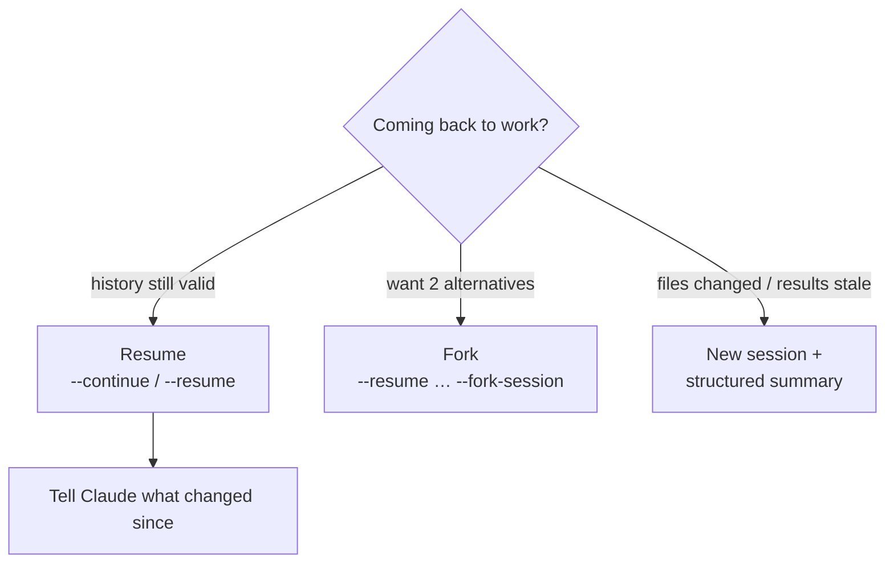
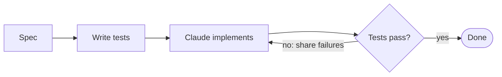

# Chapter 16 — Sessions & Iterative Workflows
{: .no_toc }

<details open markdown="block">
<summary>Contents</summary>
{: .text-delta }
1. TOC
{:toc}
</details>

---

## 🎯 Exam Snapshot

| Item | Detail |
|:--|:--|
| Domain | D3 (~20%). Overlaps with D5 context management |
| The exam tests whether you can… | 1. Choose **resume, fork or start fresh** |
| | 2. Keep **long explorations** focused (compact, summaries, subagents, manifests) |
| | 3. Refine output with **examples, tests, interviews and issue batching** |

---

## 🧠 Core Concepts

1. **Resume** (`claude --continue` for the latest, `claude --resume` to pick by name or ID) keeps the **full history**. Use it when that history is **still valid**.
2. **Fork** (`--fork-session` with resume) branches from the same point, so you can **try two approaches** without mixing them.
3. **Start fresh + summary**: when old tool results are **stale** (the code has changed), a new session with a **structured summary** beats resuming with outdated context.
4. When you resume after editing files, **tell Claude what changed** so it re-checks only those parts.
5. **Long explorations drift.** Keep them sharp with `/compact`, a **notes or scratchpad file** of key findings, and **subagents** for verbose digging.
6. **Phases + manifests**: split big work into phases, and write a **manifest file** (state, decisions, next steps) so any session or agent can pick up from it.
7. **Refinement tools**: **concrete input/output examples** when prose specs fail. **Tests first**, then iterate on the failures. An **interview** (Claude asks questions first) for unfamiliar domains.
8. **Issue batching**: send related, **interacting** issues **together** in one message, and fix **independent** ones **one at a time**.

---

## 🔀 Diagrams





---

## 📊 Session Commands

| Command | Does |
|:--|:--|
| `claude --continue` / `-c` | Resume the most recent session |
| `claude --resume` / `-r` | Pick a session (or pass its name or ID) |
| `--fork-session` | Resume into a **new branch** of history |
| `/compact [focus]` | Summarize the history to free up context |
| `/clear` | Clear the context and start over |
| `/context` | See what is using up the context |
| `/rewind` (Esc Esc) | Go back to a checkpoint |

## 📊 Refinement Techniques

| Problem | Technique |
|:--|:--|
| Output format keeps being wrong | Give **2–3 concrete input → output examples** |
| Behaviour is inconsistent | **Write tests first**, then share the failing output |
| Unfamiliar domain or unclear requirements | **Interview**: "Ask me questions before implementing" |
| Several bugs that touch the same code | **Batch** them in one message |
| Unrelated bugs | Fix them **one at a time** |

---

## 💻 Implementation — Manifest File for Phased Work

```python
# tools/manifest.py: a checkpoint any new session can read first
import json, pathlib

MANIFEST = pathlib.Path(".claude/migration-manifest.json")

def save(phase: str, done: list[str], decisions: list[str], next_steps: list[str]):
    MANIFEST.write_text(json.dumps({"phase": phase, "done": done,
                                    "decisions": decisions, "next": next_steps}, indent=2))

save(phase="2-of-4: migrate HTTP client",
     done=["src/api/*.py migrated", "tests green"],
     decisions=["use httpx.AsyncClient, timeout=10s"],
     next_steps=["migrate src/workers/", "remove requests from deps"])
```

Start a fresh session with: *"Read `.claude/migration-manifest.json` and continue from `next`."*

---

## ⚠️ Exam Traps

| Distractor | Why it's wrong | Correct choice |
|:--|:--|:--|
| Resume a week-old session after a big refactor, unchanged | Stale tool results lead to wrong edits | Start fresh with a summary, or tell Claude what changed |
| Explore two designs in the same session | The contexts mix | **Fork** the session |
| Keep describing the format in more prose | Prose is ambiguous | **Concrete examples** |
| Send 10 unrelated bugs in one message | Attention gets split | Batch only the related ones |
| Implement immediately in an unfamiliar domain | Hidden requirements get missed | The **interview** pattern first |

---

## 🔁 Quick Recall

| Q | A |
|:--|:--|
| Try two approaches from the same point? | Fork |
| Files changed and the context is stale? | Fresh session + structured summary |
| Format keeps being wrong? | Input/output examples |
| Crash-proof progress for long work? | A manifest / notes file |

---

## 🔗 References

1. [Common workflows — resume, fork](https://code.claude.com/docs/en/common-workflows)
2. [CLI reference](https://code.claude.com/docs/en/cli-reference)
3. [Claude Code best practices](https://www.anthropic.com/engineering/claude-code-best-practices)
