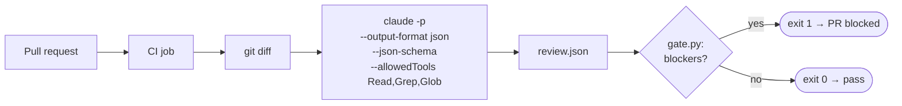
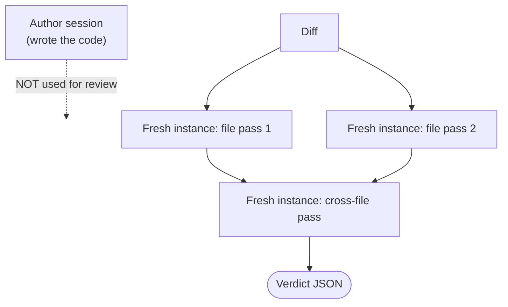

# Chapter 17 — Claude Code in CI/CD & Review Architectures
{: .no_toc }

<details open markdown="block">
<summary>Contents</summary>
{: .text-delta }
1. TOC
{:toc}
</details>

---

## 🎯 Exam Snapshot

| Item | Detail |
|:--|:--|
| Domain | D3 (~20%). This is the **Claude Code for CI/CD** scenario |
| The exam tests whether you can… | 1. Run Claude Code **non-interactively** (`-p`) with **JSON output** |
| | 2. Let a **script and exit code** decide pass or fail |
| | 3. Design **independent** and **multi-pass** reviews, and avoid duplicate comments |

---

## 🧠 Core Concepts

1. **`claude -p "…"`** (print mode) runs **once, without interaction**, and exits. Without `-p`, a CI job **hangs** waiting for input.
2. **`--output-format json`** gives machine-readable output. **`--json-schema`** forces a **verdict that matches the schema**.
3. **A script decides, not prose**: parse the JSON, then `exit 1` on blockers. Never grep free text for "LGTM".
4. **Least privilege in CI**: use `--allowedTools` to give a reviewer only read tools, and limit turns with `--max-turns`.
5. **Independent review**: the session that **wrote** the code is a poor reviewer of it, because it shares the same reasoning and blind spots. Use a **fresh, separate instance**.
6. **Multi-pass review**: **per-file passes** (local issues) plus a **cross-file pass** (interfaces, data flow). This avoids attention dilution (Ch 6).
7. **Context for CI**: CLAUDE.md supplies the testing standards and review criteria. Give **existing tests** to test generation so it doesn't duplicate them.
8. **Re-runs**: include the **previous review's findings** and ask for **new or unresolved issues only**. This avoids duplicate PR comments.
9. **Blocking vs non-blocking**: pre-merge checks are **synchronous**. Overnight bulk analysis can use the **Message Batches API** (cheaper, but up to 24h, Ch 21).

---

## 🔀 Diagrams

### CI review pipeline



### Independent, multi-pass review



---

## 📊 Key CLI Flags

| Flag | Purpose |
|:--|:--|
| `-p "prompt"` | Non-interactive print mode (**required in CI**) |
| `--output-format json` | One JSON result object (`stream-json` for streaming) |
| `--json-schema '<schema>'` | Output that matches the schema |
| `--allowedTools "Read,Grep,Glob"` | Restrict the tools |
| `--max-turns N` | Limit the loop length |
| `--append-system-prompt "…"` | Add CI-specific instructions |
| `--permission-mode plan` | Read-only analysis |

## 📊 Review Design Choices

| Problem | Solution |
|:--|:--|
| The reviewer misses bugs that the author session introduced | **Independent** instance with no shared history |
| Large PR, inconsistent findings | **Multi-pass**: per file, then cross-file |
| Duplicate comments on every push | Include the prior findings → report **new** issues only |
| Generated tests duplicate existing ones | Put the existing tests in the context |
| Too many false positives | **Explicit criteria** in the prompt / CLAUDE.md (Ch 18) |
| Nightly audit of 5,000 files | **Batch API**, non-blocking |

---

## 💻 Implementation

### A. GitHub Actions workflow


```yaml
name: claude-review
on: pull_request
jobs:
  review:
    runs-on: ubuntu-latest
    steps:
      - uses: actions/checkout@v4
        with: { fetch-depth: 0 }
      - run: npm install -g @anthropic-ai/claude-code
      - name: Claude review
        env:
          ANTHROPIC_API_KEY: ${{ secrets.ANTHROPIC_API_KEY }}
        run: |
          git diff origin/${{ github.base_ref }}...HEAD > diff.txt
          claude -p "Review diff.txt using CLAUDE.md review criteria. \
                     Prior findings: see .review/previous.json. Report NEW issues only." \
            --output-format json \
            --json-schema "$(cat .github/review-schema.json)" \
            --allowedTools "Read,Grep,Glob" \
            --max-turns 15 > review.json
          python .github/gate.py review.json
```


### B. Gate script — the exit code decides

```python
# .github/gate.py
import json, sys

result = json.load(open(sys.argv[1]))
review = result["structured_output"]          # schema-valid verdict from --json-schema
blockers = [i for i in review["issues"] if i["severity"] == "blocker"]

for i in blockers:                            # GitHub annotation format
    print(f"::error file={i['file']},line={i['line']}::{i['message']}")

sys.exit(1 if blockers else 0)                # 1 = fail the PR check
```

1. `-p` plus JSON plus a schema gives a **parseable verdict**, never free text.
2. **Read-only tools** and `--max-turns` keep the CI run safe and bounded.
3. **Python decides** pass or fail, which makes the check deterministic.

{: .note }
Anthropic also provides a ready-made **Claude Code GitHub Action** (`anthropics/claude-code-action`). The same principles apply.

---

## ⚠️ Exam Traps

| Distractor | Why it's wrong | Correct choice |
|:--|:--|:--|
| Run `claude "review"` in CI without `-p` | It waits for input, so the job hangs | `claude -p` |
| Grep the text output for "approved" | Fragile parsing of prose | `--output-format json` + `--json-schema` |
| Ask the author session to review its own changes | Shared blind spots | An **independent** instance |
| One prompt for a 40-file PR | Attention dilution | **Multi-pass**: per file + cross-file |
| Re-review every push from scratch | Duplicate comments | Include the prior findings, report new ones only |
| Batch API for the pre-merge gate | Up to 24h latency | Synchronous call. Use batches only for non-blocking jobs |
| Give the CI reviewer Bash and Write | Too much privilege | Read, Grep and Glob only |

---

## 🧩 Scenario Mini-Case

**CI/CD:** the team complains that *"Claude posts the same 12 comments on every push, and the job sometimes hangs."*

| Symptom | Cause | Fix |
|:--|:--|:--|
| Hangs | No `-p` | Print mode |
| Duplicate comments | No memory of the previous review | Pass `previous.json` and ask for new issues only |
| Missed cross-module bug | A single pass | Add a cross-file pass |

---

## 🔁 Quick Recall

| Q | A |
|:--|:--|
| Non-interactive flag? | `-p` |
| Schema-valid CI output? | `--output-format json` + `--json-schema` |
| What decides pass or fail? | A script's exit code |
| Why an independent reviewer? | The author session shares the same blind spots |
| How to avoid duplicate comments? | Include the prior findings, report only new ones |

---

## 🔗 References

1. [Headless / programmatic mode (`-p`)](https://code.claude.com/docs/en/headless)
2. [CLI reference (flags)](https://code.claude.com/docs/en/cli-reference)
3. [Claude Code GitHub Actions](https://code.claude.com/docs/en/github-actions)
