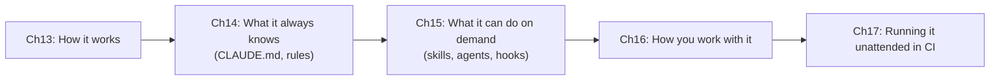

# Part D — Claude Code Configuration & Workflows
{: .no_toc }

**Domain 3 · ~20% of the exam.** It is central to the **code generation**, **developer productivity** and **CI/CD** scenarios.
{: .fs-5 }

| Ch | Title | Pages | You must be able to… |
|:--|:--|:--|:--|
| 13 | [Architecture, Tools & Permissions](13-claude-code-architecture.html) | 4 | Pick the right built-in tool, permission mode, and plan mode vs direct execution |
| 14 | [CLAUDE.md, Rules & Memory](14-claude-md-rules.html) | 4 | Put instructions at the right level, and scope rules by path |
| 15 | [Commands, Skills, Subagents & Hooks](15-skills-subagents-hooks.html) | 4 | Know where each one lives and when to use which |
| 16 | [Sessions & Iterative Workflows](16-sessions-workflows.html) | 2 | Resume, fork or start fresh, and refine with examples and tests |
| 17 | [Claude Code in CI/CD & Review](17-ci-cd-review.html) | 3 | Run `-p` with JSON output, and design independent, multi-pass review |

{: .key }
**Always-needed team knowledge → CLAUDE.md or rules. Task-specific workflows → skills. Must-always-happen → hooks.**
