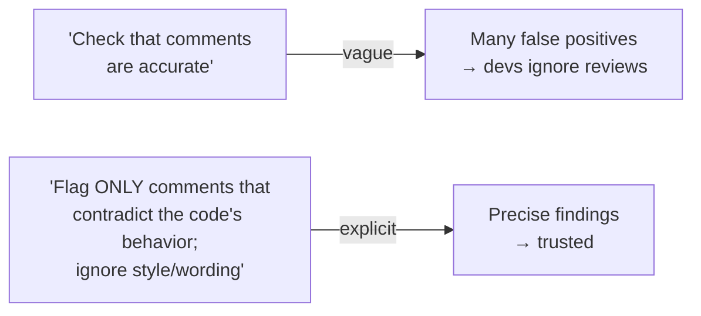
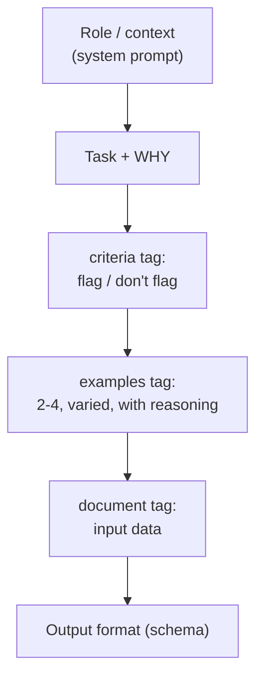

# Chapter 18 — Prompt Engineering Core
{: .no_toc }

<details open markdown="block">
<summary>Contents</summary>
{: .text-delta }
1. TOC
{:toc}
</details>

---

## 🎯 Exam Snapshot

| Item | Detail |
|:--|:--|
| Domain | D4 Prompt Engineering & Structured Output (~20%) |
| The exam tests whether you can… | 1. Replace vague instructions with **explicit, categorical criteria** |
| | 2. Use **few-shot examples** for format, judgment and extraction |
| | 3. Decide what belongs in the **prompt** and what belongs in **code** |

---

## 🧠 Core Concepts

1. **Be explicit.** Claude follows what you *say*, not what you *meant*. State the task, the audience, the format and the **criteria**.
2. **False positives** (flagging things that are fine) come from **vague criteria**. Fix them with **specific categories** of what to flag *and what not to flag*.
3. *"Be conservative"* or *"only report high-confidence issues"* **don't work well**. They don't tell Claude **what** counts.
4. **Define severity with concrete examples** for each level (blocker, major, minor), so the ratings stay consistent.
5. **If one category is noisy**, temporarily **turn it off**. That restores trust while you rewrite its criteria.
6. **Few-shot examples** (2–4) teach **format** and **judgment** better than paragraphs of rules. Make them **varied** and include **edge cases**.
7. For hard judgment calls, show the **reasoning**: *why* option A and not the plausible option B.
8. **Few-shot for extraction**: show documents with **different layouts** (inline vs table, citations vs bibliography) so the model generalizes instead of guessing.
9. **Structure with XML tags** (`<document>`, `<criteria>`, `<examples>`) so the instructions, the data and the examples stay clearly separate.
10. **Give the reason** behind a rule ("…because the TTS engine can't read ellipses"). Claude applies rules better when it knows why.

{: .key }
Prompts shape **judgment**. Code enforces **guarantees** (Ch 8). Never rely on a prompt alone for a rule that must never be broken.

---

## 🔀 Diagrams

### From noisy to precise



### Anatomy of a strong prompt



---

## 📊 Vague vs Explicit Criteria

| ❌ Vague | ✅ Explicit |
|:--|:--|
| "Find security issues." | "Flag: SQL built by string concatenation, secrets in code, missing authz checks on `/admin/*`. Don't flag: test fixtures, commented-out code." |
| "Be conservative." | "Report only issues that would cause wrong output, data loss or a security hole." |
| "Rate severity." | "**Blocker**: data loss / security (e.g. unparameterized SQL). **Major**: wrong behaviour (e.g. off-by-one in pagination). **Minor**: maintainability." |
| "Escalate difficult cases." | "Escalate if: the customer asks for a human, the refund is over $500, or no policy covers the request. Otherwise resolve it." |

## 📊 Few-Shot: When and How

| Use for | Example content | Tip |
|:--|:--|:--|
| **Output format** | 2 inputs → the exact JSON or markdown wanted | Keep the format identical across examples |
| **Judgment** | Ambiguous case → decision + **why not the alternative** | Include "don't flag" examples too |
| **Extraction** | Docs with different layouts → the same fields | Show `null` when a field is missing |
| **Tool selection** | Request → which tool and why | Fix the descriptions first (Ch 9) |

| Pitfall | Fix |
|:--|:--|
| All examples look alike, so Claude over-fits | Vary the length, layout and edge cases |
| Examples contradict the instructions | Make them consistent, because examples usually win |
| Only positive examples | Add negative ("acceptable, don't flag") examples |

---

## 💻 Implementation — Explicit Criteria + Few-Shot in XML

```python
import anthropic
client = anthropic.Anthropic()

SYSTEM = "You are a code reviewer for a Python payments service."

PROMPT = """Review the diff. Reviews are posted to PRs, so false positives waste
developer time: flag only real problems.

<criteria>
FLAG: comments that contradict what the code does; unparameterized SQL;
      secrets in code; money stored as float.
DO NOT FLAG: style, naming, wording of comments, TODOs, test fixtures.
</criteria>

<examples>
<example>
<code># returns amount in cents
def total(o): return o.amount_dollars</code>
<finding>FLAG (major): comment says cents, code returns dollars.</finding>
</example>
<example>
<code># calc total
def total(o): return o.amount_cents</code>
<finding>NO FLAG: terse comment, but not wrong. Style only.</finding>
</example>
</examples>

<diff>
{diff}
</diff>

Return one line per finding: severity | file:line | problem | fix."""

resp = client.messages.create(
    model="claude-sonnet-5-5", max_tokens=1024, system=SYSTEM,
    messages=[{"role": "user", "content": PROMPT.format(diff=open("pr.diff").read())}])
print(resp.content[0].text)
```

1. The criteria list both **flag** and **don't flag** cases.
2. The two examples teach the **boundary** (contradicts the code vs only terse).
3. XML tags keep the instructions, examples and data **separate**.

---

## ⚠️ Exam Traps

| Distractor | Why it's wrong | Correct choice |
|:--|:--|:--|
| Too many false positives → "tell Claude to be more conservative" | Gives no criteria | **Explicit flag / don't-flag categories** |
| "Only report findings with confidence > 90%" | Self-reported confidence is poorly calibrated | Specific criteria |
| Inconsistent severity → "ask for consistent severity" | Undefined scale | **A severity rubric with code examples** |
| One category is very noisy → keep it and hope | Developers lose trust in *all* findings | **Turn that category off** temporarily and refine it |
| 10 near-identical few-shot examples | Over-fitting, and wasted tokens | 2–4 **varied** examples, including edge cases |
| "Never refund > $500" only in the prompt | Probabilistic | Enforce in code (Ch 8) |

---

## 🧩 Scenario Mini-Case

**CI review:** developers ignore Claude's PR comments. 40% of them are about comment wording.

| Step | Action |
|:--|:--|
| 1 | Turn off the "comment quality" category to restore trust |
| 2 | Rewrite it: flag **only** comments that **contradict** the code's behaviour |
| 3 | Add 2 few-shot examples (contradiction → flag, terse but true → no flag) |
| 4 | Measure the false-positive rate on a test set before turning it back on (Ch 19) |

---

## 🔁 Quick Recall

| Q | A |
|:--|:--|
| The #1 fix for false positives? | Explicit, categorical criteria |
| How many few-shot examples? | 2–4, varied, with edge cases |
| How do you make severity consistent? | A rubric with a concrete example per level |
| How do you separate instructions from data? | XML tags |
| A rule that must never break? | Code, not the prompt |

---

## 🔗 References

1. [Prompt engineering overview — Claude Docs](https://docs.claude.com/en/docs/build-with-claude/prompt-engineering/overview)
2. [Be clear and direct](https://docs.claude.com/en/docs/build-with-claude/prompt-engineering/be-clear-and-direct)
3. [Use examples (multishot prompting)](https://docs.claude.com/en/docs/build-with-claude/prompt-engineering/multishot-prompting)
4. [Use XML tags](https://docs.claude.com/en/docs/build-with-claude/prompt-engineering/use-xml-tags)
