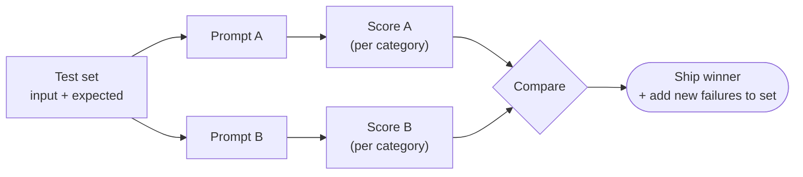

# Chapter 19 — Evaluating Prompts with Test Sets
{: .no_toc }

<details open markdown="block">
<summary>Contents</summary>
{: .text-delta }
1. TOC
{:toc}
</details>

---

## 🎯 Exam Snapshot

| Item | Detail |
|:--|:--|
| Domain | D4 (~20%), with links to D5 reliability |
| The exam tests whether you can… | 1. Judge prompt changes by **scores on a test set**, not by "it looks better" |
| | 2. Spot **aggregate metrics hiding per-category failures** |
| | 3. Use **sampling** to check results in production |

---

## 🧠 Core Concepts

1. A **test set** is a list of inputs, each with an **expected verdict** (the label). Start small (6–20 cases) and keep adding.
2. Include **easy, edge and negative** cases ("should NOT flag"), plus every **past production failure** as a regression case.
3. **Score in code**: exact match, field match, or set overlap. Use an **LLM-as-judge** with a rubric only for subjective qualities.
4. **Compare prompts A and B on the same set**. The higher score wins, not the more convincing-looking output.
5. Track **false positives** and **false negatives** separately. They have different costs.
6. **Break the score down by category or document type.** A 95% overall score can hide 60% on handwritten invoices.
7. **Run evals in CI** whenever a prompt file changes, so a regression is caught before merge.
8. In production, **sample even the high-confidence results** (stratified random sampling) to measure the real error rate.

---

## 🔀 Diagram



---

## 📊 Scoring Methods

| Method | Use for | Example |
|:--|:--|:--|
| **Exact / label match** | Classification, verdicts | `FLAG` vs `NO_FLAG` |
| **Field-level match** | Extraction | 9 of 10 fields correct |
| **Code checks** | Format, schema, rules | JSON is valid, total = sum |
| **LLM-as-judge (with a rubric)** | Tone, helpfulness | Score 1–5 against criteria |
| **Human review** | Ground truth, calibration | Spot-check samples |

## 📊 Reading Results

| Observation | Meaning | Action |
|:--|:--|:--|
| Overall up, one category down | A regression is hidden by the average | Fix it before shipping |
| High false positives | Criteria too broad | Narrow the "flag" criteria (Ch 18) |
| High false negatives | Criteria too narrow, or missing examples | Add examples and categories |
| Score bounces between runs | Too few cases, or randomness | More cases, several runs |

---

## 💻 Implementation — A Tiny Eval Harness

```python
from collections import defaultdict
import anthropic

client = anthropic.Anthropic()

TEST_SET = [  # (category, input, expected)
    ("contradiction", "# returns cents\ndef t(o): return o.dollars", "FLAG"),
    ("terse_ok",      "# calc total\ndef t(o): return o.cents",     "NO_FLAG"),
    ("sql",           "q = 'SELECT * FROM u WHERE id=' + uid",       "FLAG"),
    ("sql",           "cur.execute('SELECT * FROM u WHERE id=%s', (uid,))", "NO_FLAG"),
    ("style",         "def CalcTotal(o): return o.cents",             "NO_FLAG"),
    ("secret",        "API_KEY = 'sk-live-123'",                      "FLAG"),
]

def verdict(prompt: str, code: str) -> str:
    r = client.messages.create(model="claude-sonnet-5-5", max_tokens=10,
        messages=[{"role": "user", "content": f"{prompt}\n<code>{code}</code>\n"
                   "Answer with exactly FLAG or NO_FLAG."}])
    return r.content[0].text.strip()

def score(prompt: str) -> dict:
    per_cat = defaultdict(lambda: [0, 0])               # category -> [correct, total]
    for cat, code, expected in TEST_SET:
        per_cat[cat][0] += verdict(prompt, code) == expected
        per_cat[cat][1] += 1
    return {cat: f"{c}/{t}" for cat, (c, t) in per_cat.items()}

print("A:", score("Check this code for problems."))
print("B:", score("Flag ONLY: comments contradicting code, unparameterized SQL, "
                  "hard-coded secrets. Do not flag style or naming."))
```

1. The expected verdicts make the comparison **objective**.
2. **Per-category** scores reveal where a prompt fails.
3. Run the same script in CI whenever a prompt changes.

---

## ⚠️ Exam Traps

| Distractor | Why it's wrong | Correct choice |
|:--|:--|:--|
| "The new prompt's outputs look better, so ship it" | Anecdotal | Score both prompts on the same test set |
| 97% overall accuracy → stop human review | It can hide a weak document type | Check **per category**, then decide |
| A test set with only positive cases | Can't measure false positives | Add "should not flag" cases |
| Check only low-confidence results | High-confidence errors go unseen | **Sample** the high-confidence results too |
| Fix a production bug without adding a test case | It can come back | Add it to the set as a regression case |

---

## 🔁 Quick Recall

| Q | A |
|:--|:--|
| What makes a test case? | An input + an expected verdict |
| Compare two prompts how? | Same test set, scored in code |
| Why break scores down per category? | Averages hide weak segments |
| Check high-confidence output how? | Stratified random sampling |

---

## 🔗 References

1. [Define success criteria](https://docs.claude.com/en/docs/test-and-evaluate/define-success)
2. [Develop test cases / evals](https://docs.claude.com/en/docs/test-and-evaluate/develop-tests)
3. [Demystifying evals for AI agents — Anthropic Engineering](https://www.anthropic.com/engineering/demystifying-evals-for-ai-agents)
