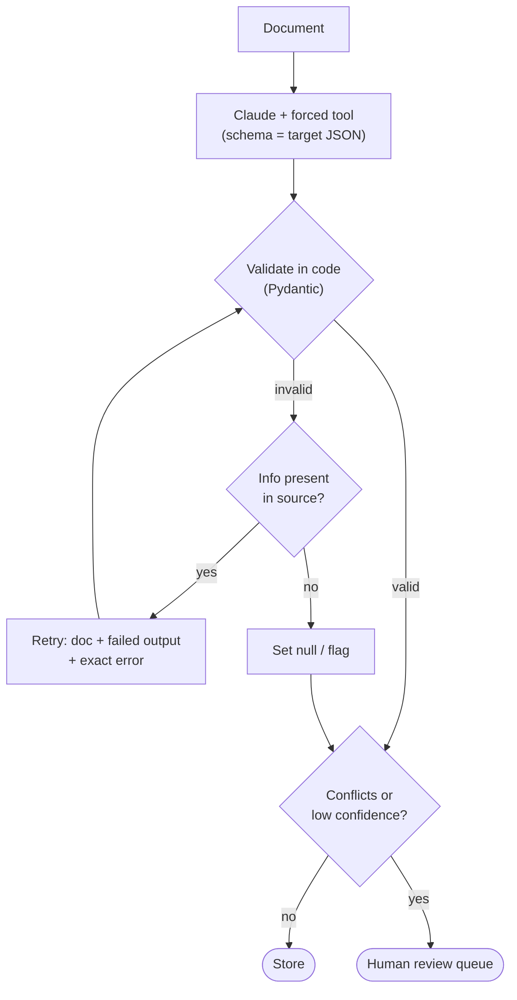
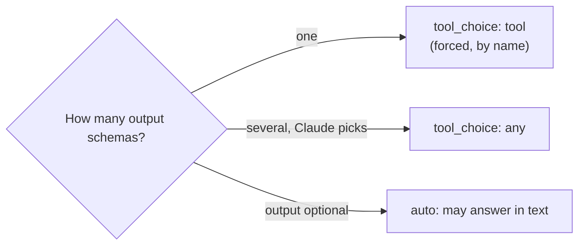

# Chapter 20 — Structured Output & Extraction
{: .no_toc }

<details open markdown="block">
<summary>Contents</summary>
{: .text-delta }
1. TOC
{:toc}
</details>

---

## 🎯 Exam Snapshot

| Item | Detail |
|:--|:--|
| Domain | D4 (~20%). This is the **structured data extraction** scenario |
| The exam tests whether you can… | 1. Get **schema-valid JSON** through tool use and `tool_choice` |
| | 2. Design schemas that **don't force made-up values** (nullable, enum + other) |
| | 3. **Validate → retry with the error**, and know when a retry **can't** help |
| | 4. Route uncertain results to **human review** using calibrated confidence |

---

## 🧠 Core Concepts

1. **Tool use as an output format**: define a tool whose `input_schema` *is* your target schema, then **force** it with `tool_choice`. Claude's "tool input" is your JSON.
2. A schema prevents **syntax** errors (malformed JSON, missing required keys), **not semantic** ones (a wrong value in the right field, totals that don't add up).
3. **Nullable fields**: if a field may be missing from the document, allow `null`. A required non-null field **pushes Claude to invent** a value.
4. **Enums + "other" + a detail field** (and maybe `"unclear"`) handle unexpected values honestly.
5. **Validate in code** (for example with Pydantic) after every extraction.
6. **Retry with the error**: send back the **original document**, the **failed output** and the **exact validation error**. Ask Claude to fix *only* those fields.
7. **A retry can't create missing information.** If the value isn't in the source, retrying produces a guess. Return `null` or **flag the document for review**.
8. **Fields that expose errors**: extract `stated_total` **and** compute `calculated_total`. Add flags like `conflict_detected`. Mismatches become **visible** instead of hidden.
9. **Confidence**: ask for confidence **per field**, but **calibrate** the threshold on a labelled set. Raw self-reported confidence is unreliable.
10. **Human review routing**: low confidence, a validation conflict, or a high-stakes field → a person. Also **sample** the high-confidence results (Ch 19).

---

## 🔀 Diagrams

### Extraction pipeline



### `tool_choice` for structured output



---

## 📊 Schema Design for Extraction

| Problem | Schema fix |
|:--|:--|
| The model invents a due date that isn't in the document | `"due_date": {"type": ["string","null"]}` |
| Unexpected currency values | `enum: ["USD","EUR","GBP","other"]` + `currency_other` |
| A field is ambiguous in the source | Add `"unclear"` to the enum, or a `notes` field |
| Arithmetic errors go unnoticed | `stated_total` + `calculated_total` (computed in code) |
| Two sources in the document disagree | `conflict_detected: bool` + `conflict_detail` |
| You need to know which fields are uncertain | `field_confidence: {field: 0-1}` |

## 📊 Retry or Not?

| Validation error | Retry helps? | Action |
|:--|:--:|:--|
| Wrong format (`"03/04/25"` instead of ISO) | ✅ | Retry with the error message |
| A value is in the wrong field | ✅ | Retry with the error + the document |
| A required value is **not in the document** | ❌ | Allow `null` / flag for review |
| Totals mismatch **in the source itself** | ❌ | Flag `conflict_detected` → human review |
| Same error after 2 retries | ❌ | Stop and route to a human |

---

## 💻 Implementation — Forced Tool + Pydantic + Retry

```python
from typing import Literal, Optional
import anthropic
from pydantic import BaseModel, ValidationError

client = anthropic.Anthropic()

class LineItem(BaseModel):
    description: str
    amount: float

class Invoice(BaseModel):
    invoice_id: str
    vendor: str
    due_date: Optional[str]                       # nullable: never force a guess
    currency: Literal["USD", "EUR", "GBP", "other"]
    line_items: list[LineItem]
    stated_total: float

TOOL = {"name": "record_invoice",
        "description": "Record data extracted from ONE invoice. Use null if a value is absent.",
        "input_schema": Invoice.model_json_schema()}

def extract(doc: str, max_retries: int = 2) -> Invoice:
    messages = [{"role": "user", "content": f"Extract this invoice.\n<doc>\n{doc}\n</doc>"}]
    for _ in range(max_retries + 1):
        r = client.messages.create(
            model="claude-sonnet-5-5", max_tokens=2048, tools=[TOOL],
            tool_choice={"type": "tool", "name": "record_invoice"},   # forced
            messages=messages)
        call = next(b for b in r.content if b.type == "tool_use")
        try:
            return Invoice.model_validate(call.input)
        except ValidationError as e:              # retry WITH the exact error
            messages += [
                {"role": "assistant", "content": r.content},
                {"role": "user", "content": [{
                    "type": "tool_result", "tool_use_id": call.id, "is_error": True,
                    "content": f"Validation failed:\n{e}\nFix only these fields "
                               "using the document. Use null if the value is absent."}]}]
    raise ValueError("Extraction failed after retries: route to human review")

def needs_review(inv: Invoice) -> bool:
    calculated_total = round(sum(i.amount for i in inv.line_items), 2)
    return abs(calculated_total - inv.stated_total) > 0.01   # expose, don't hide
```

1. The **forced tool** guarantees a structured response, and **Pydantic** checks it.
2. The retry carries the **document (in the history), the failed output and the exact error**.
3. A totals mismatch is **flagged for review**, not "fixed" by retrying.

{: .note }
The Claude API also offers **structured outputs** (a JSON-schema response format, and `strict: true` on tools). The concepts are the same: the schema guarantees syntax, and **your code still checks the meaning**.

---

## ⚠️ Exam Traps

| Distractor | Why it's wrong | Correct choice |
|:--|:--|:--|
| "Schema-valid output means correct output" | A schema catches syntax, not meaning | Add semantic checks in code |
| Make every field required and non-null | Forces Claude to invent values | Nullable optional fields |
| Retry with "please try again" | No information about what to fix | Doc + failed output + **exact error** |
| Retry until a missing value appears | It isn't in the source, so you get a guess | Null or flag → human |
| Ask "return JSON" in plain text for a pipeline | Can return malformed or partial output | Forced tool / structured outputs |
| Route on raw self-reported confidence | Poorly calibrated | Calibrate the thresholds on labelled data |
| Silently "correct" a total mismatch | Hides a real discrepancy | `calculated_total` vs `stated_total` → review |

---

## 🧩 Scenario Mini-Case

**Extraction:** invoices from 200 vendors. About 4% have a `due_date` that is invented, and some totals don't match their line items.

| Issue | Fix |
|:--|:--|
| Invented due dates | Make `due_date` **nullable**, and add a few-shot example with `null` |
| Total mismatches | Compute `calculated_total` in code and route mismatches to review |
| Format errors | Validate → retry with the exact Pydantic error (max 2) |
| Trust check | Report accuracy per vendor type and sample the high-confidence results |

---

## 🔁 Quick Recall

| Q | A |
|:--|:--|
| Guarantee JSON matching a schema? | A forced tool (`tool_choice: tool`) or structured outputs |
| Several possible schemas? | `tool_choice: any` |
| Stop invented values? | Nullable fields, plus enum "other" or "unclear" |
| A good retry includes? | The document + the failed output + the exact error |
| When is a retry useless? | When the information isn't in the source |

---

## 🔗 References

1. [Tool use: JSON output with tools](https://docs.claude.com/en/docs/agents-and-tools/tool-use/implement-tool-use)
2. [Structured outputs — Claude Docs](https://docs.claude.com/en/docs/build-with-claude/structured-outputs)
3. [Increase output consistency](https://docs.claude.com/en/docs/test-and-evaluate/strengthen-guardrails/increase-consistency)
4. [Pydantic documentation](https://docs.pydantic.dev/latest/)
