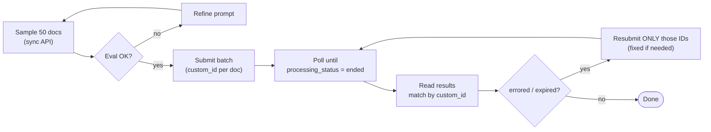

# Chapter 21 — Batch Processing (Message Batches API)
{: .no_toc }

<details open markdown="block">
<summary>Contents</summary>
{: .text-delta }
1. TOC
{:toc}
</details>

---

## 🎯 Exam Snapshot

| Item | Detail |
|:--|:--|
| Domain | D4 (~20%) |
| The exam tests whether you can… | 1. Decide when batching **fits** (cost) and when it **doesn't** (latency) |
| | 2. Use **`custom_id`** to match results and **resubmit only the failures** |
| | 3. **Test on a sample** before running the full batch |

---

## 🧠 Core Concepts

1. The **Message Batches API** sends many independent `messages` requests **asynchronously** at about **50% of the cost**.
2. Processing finishes **within 24 hours** (often much sooner), but there is **no latency guarantee**.
3. **Fits**: overnight reports, back-catalogue extraction, nightly audits, bulk classification.
4. **Doesn't fit**: anything a user or a **pre-merge check is waiting for**, or **multi-turn tool loops** (your code can't run a tool in the middle of a batch request).
5. **`custom_id`**: your own key for each request. Results **may come back in any order**, so always match them on `custom_id`.
6. Each result has a **type**: `succeeded`, `errored`, `canceled` or `expired`. **Resubmit only the failed IDs**, changed if needed (for example, split a document that was too long).
7. **Refine first**: run the prompt on a **small sample** with the normal API, evaluate it (Ch 19), and only then batch thousands.
8. **SLA planning**: if results are due within 30h and a batch can take 24h, **submit at least every 6h**, or a document that arrives just after a submission misses the deadline.

---

## 🔀 Diagram



---

## 📊 Batch vs Synchronous

| | Synchronous `messages.create` | Message Batches API |
|:--|:--|:--|
| Latency | Seconds | Up to 24h |
| Cost | Standard | About **50% less** |
| Multi-turn tool use | ✅ | ❌ (one request, one response) |
| Best for | Interactive use, pre-merge gates | Bulk, non-blocking work |
| Result order | – | **Not guaranteed**, so use `custom_id` |

## 📊 Handling Result Types

| Type | Meaning | Action |
|:--|:--|:--|
| `succeeded` | A message was returned | Validate it (Ch 20) and store it |
| `errored` | The request was invalid or there was a server error | Fix the request if it was invalid, then resubmit |
| `expired` | Not processed within 24h | Resubmit |
| `canceled` | The batch was cancelled | Resubmit if still needed |

---

## 💻 Implementation

```python
import anthropic
client = anthropic.Anthropic()

docs = {"inv-001": "...", "inv-002": "...", "inv-003": "..."}

def request(doc_id: str, text: str) -> dict:
    return {"custom_id": doc_id,                          # your key for matching
            "params": {"model": "claude-sonnet-5-5", "max_tokens": 2048,
                       "tools": [TOOL],                     # same tool as Ch 20
                       "tool_choice": {"type": "tool", "name": "record_invoice"},
                       "messages": [{"role": "user", "content": f"<doc>{text}</doc>"}]}}

batch = client.messages.batches.create(
    requests=[request(i, t) for i, t in docs.items()])

# ... later (poll, or run as a scheduled job)
if client.messages.batches.retrieve(batch.id).processing_status == "ended":
    failed = []
    for res in client.messages.batches.results(batch.id):  # any order
        if res.result.type == "succeeded":
            save(res.custom_id, res.result.message)          # then validate (Ch 20)
        else:
            failed.append(res.custom_id)
    if failed:                                             # resubmit ONLY failures
        client.messages.batches.create(
            requests=[request(i, docs[i]) for i in failed])
```

1. `custom_id` links each result back to its document.
2. Only the **failed** IDs are resubmitted.
3. One request gets one response, with **no tool loop** inside the batch.

---

## ⚠️ Exam Traps

| Distractor | Why it's wrong | Correct choice |
|:--|:--|:--|
| Use batches for the pre-merge PR check to save cost | Up to 24h latency blocks developers | Synchronous calls |
| Batch an agent that needs several tool rounds | You can't run tools in the middle of a request | Synchronous agentic loop |
| Match results by list position | The order isn't guaranteed | `custom_id` |
| Resubmit the whole batch when 3% fail | Wastes cost and time | Resubmit the failed IDs only |
| Batch 50,000 documents with an untested prompt | Errors multiply at scale | Sample → evaluate → then batch |

---

## 🔁 Quick Recall

| Q | A |
|:--|:--|
| Batch discount and time window? | About 50%, up to 24h |
| How do you match results? | `custom_id` |
| Can a batch request run a tool loop? | No |
| What do you resubmit? | Only the failed IDs |
| What comes before a large batch? | Testing the prompt on a sample |

---

## 🔗 References

1. [Batch processing — Claude Docs](https://docs.claude.com/en/docs/build-with-claude/batch-processing)
2. [Message Batches API reference](https://docs.claude.com/en/api/creating-message-batches)
3. [Pricing (batch discount)](https://docs.claude.com/en/docs/about-claude/pricing)
