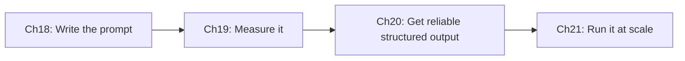

# Part E — Prompt Engineering & Structured Output
{: .no_toc }

**Domain 4 · ~20% of the exam.** It is central to the **structured data extraction** scenario and to CI review quality.
{: .fs-5 }

| Ch | Title | Pages | You must be able to… |
|:--|:--|:--|:--|
| 18 | [Prompt Engineering Core](18-prompt-engineering.html) | 4 | Cut false positives with explicit criteria, and use few-shot examples well |
| 19 | [Evaluating Prompts with Test Sets](19-prompt-evaluation.html) | 2 | Prove that a prompt change helps, using scored test cases |
| 20 | [Structured Output & Extraction](20-structured-extraction.html) | 4 | Get schema-valid JSON, validate and retry, and route uncertain results to humans |
| 21 | [Batch Processing](21-batch-processing.html) | 2 | Know when the Message Batches API fits, and handle `custom_id` and failures |

{: .key }
**Vague instructions give vague results.** Specific criteria, examples and schemas give consistent ones, and **only a test set proves it**.
