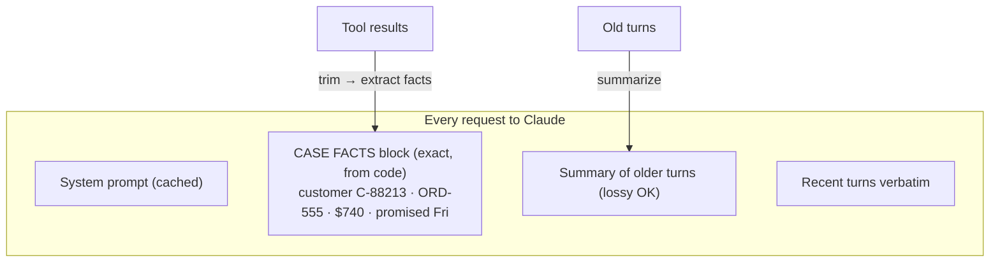
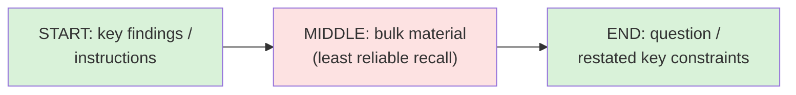

# Chapter 22 — Context Management
{: .no_toc }

<details open markdown="block">
<summary>Contents</summary>
{: .text-delta }
1. TOC
{:toc}
</details>

---

## 🎯 Exam Snapshot

| Item | Detail |
|:--|:--|
| Domain | D5 Context Management & Reliability (~15%) |
| The exam tests whether you can… | 1. Stop **summaries from losing exact facts** (amounts, dates, IDs, promises) |
| | 2. Handle **lost-in-the-middle** and **tool-output bloat** |
| | 3. Pass **compact, structured context** between agents |
| | 4. Keep long sessions focused (scratchpads, compaction, subagents) |

---

## 🧠 Core Concepts

1. **Everything Claude knows is in the request.** The context window is finite, and every token you add competes for attention.
2. **Progressive summarization loses detail.** "$740 refund promised by Friday for ORD-555" turns into *"customer discussed a refund"*.
3. **Case facts block**: pull the **exact transactional facts** (IDs, amounts, dates, statuses, promises) into a structured block, **held in code** and **sent with every request**, outside the summarized history.
4. **Lost in the middle**: models use information at the **start and end** of long inputs most reliably. Put **key findings first**, and use **clear section headers**.
5. **Tool results pile up fast.** One order lookup can return 40 fields when only 5 matter. **Trim** them before adding them to the history (Ch 10).
6. **Between agents**: send **structured essentials** (facts, citations, scores), not full transcripts. The receiving agent has its own limited budget.
7. **Long sessions drift**: answers become generic ("typically…") instead of specific. Fix this with a **scratchpad or notes file**, **`/compact`**, or **subagents** for verbose work (Ch 16).
8. **Prompt caching**: cache the **stable prefix** (tools, system prompt, large documents) to cut cost and latency. It doesn't change what Claude sees.
9. **The API is stateless.** Your code sends the full (managed) history each turn. Managing context means **choosing what goes in it**.

---

## 🔀 Diagrams

### Case facts survive summarization



### Where to place key information



---

## 📊 Problems and Fixes

| Symptom | Cause | Fix |
|:--|:--|:--|
| The agent forgets the promised refund amount after 30 turns | A lossy summary | **Case facts block**, held in code |
| A fact buried in a long document is missed | Lost in the middle | Key facts **first**, headers, restate at the end |
| Context fills up after a few lookups | Verbose tool output | **Trim** fields, paginate, summarize |
| A subagent's 20-page report overwhelms the synthesizer | An unstructured handoff | **Structured** output: claims, sources, scores |
| Session answers get vague over time | Context degradation | Scratchpad file, `/compact`, a fresh session + summary |
| High cost from a repeated 50-page policy | Resent every call at full price | **Prompt caching** on the stable prefix |

## 📊 What to Keep Exact vs What to Summarize

| Keep **exact** (case facts) | OK to **summarize** |
|:--|:--|
| Customer, order and ticket IDs | Small talk, greetings |
| Amounts, dates, deadlines | Troubleshooting steps already ruled out |
| **Promises made** to the customer | The general history of the conversation |
| Current status, actions taken | The wording of earlier explanations |
| Verified identity | Tool calls that failed and were retried |

---

## 💻 Implementation — Case Facts + Trimming + Caching

```python
import json
import anthropic
client = anthropic.Anthropic()

POLICY = open("support_policy.md").read()        # large and stable -> cache it

case_facts = {}                                   # exact facts, owned by CODE

def record_facts(tool_name: str, result: dict):
    if tool_name == "lookup_order":               # trim 40 fields -> the ones we need
        case_facts.update(order_id=result["id"], amount=result["total"],
                          status=result["status"], delivered=result["delivered_at"])

def ask(history: list, summary_of_old_turns: str):
    system = [
        {"type": "text", "text": POLICY,
         "cache_control": {"type": "ephemeral"}},             # cached prefix
        {"type": "text", "text":
         "<case_facts>\n" + json.dumps(case_facts, indent=1) + "\n</case_facts>\n"
         "<earlier_summary>\n" + summary_of_old_turns + "\n</earlier_summary>"},
    ]
    return client.messages.create(model="claude-sonnet-5-5", max_tokens=1024,
                                  system=system, messages=history[-10:])  # recent turns
```

1. **Case facts** are written by code from tool results, so summarization can't blur them.
2. Older turns are summarized, while the **last 10** are kept word for word.
3. The big, stable policy is **cached**. The changing parts come **after** the cached prefix.

{: .note }
Caching matches the **exact prefix**. Anything that changes (case facts, the summary) must come **after** the `cache_control` breakpoint, or the cache is never used.

---

## ⚠️ Exam Traps

| Distractor | Why it's wrong | Correct choice |
|:--|:--|:--|
| "Use a bigger context window" to fix forgotten facts | Attention still dilutes, and cost grows | A case facts block + trimming |
| Summarize everything, including amounts and dates | Exact values get lost | Keep transactional facts **exact**, outside the summary |
| Put the critical instruction in the middle of a long prompt | Lost in the middle | Put it at the start, and restate it at the end |
| Add raw tool output in full "in case it's needed" | Context bloat | Trim to the relevant fields |
| Pass the full transcript to every subagent | Wastes the receiver's budget | Structured essentials |
| Prompt caching "improves accuracy" | It only saves cost and latency | Caching is about cost and latency, not quality |

---

## 🧩 Scenario Mini-Case

**Support:** after 40 turns the agent tells the customer *"a refund was discussed"* and offers $500, but $740 had been agreed.

| Step | Fix |
|:--|:--|
| Root cause | Progressive summarization dropped the exact amount and the promise |
| Fix | `case_facts = {order: ORD-555, agreed_refund: 740, promised_by: Fri}`, sent with every request |
| Bonus | Trim the `lookup_order` output, and cache the policy prefix |

---

## 🔁 Quick Recall

| Q | A |
|:--|:--|
| Where do exact amounts and dates live in a long conversation? | A case facts block, held in code |
| Which part of a long input is least reliably used? | The middle |
| Fix for tool-output bloat? | Trim to the relevant fields |
| What does prompt caching improve? | Cost and latency, not accuracy |
| A long session is getting vague? | Scratchpad, `/compact`, or a fresh session + summary |

---

## 🔗 References

1. [Effective context engineering for AI agents — Anthropic Engineering](https://www.anthropic.com/engineering/effective-context-engineering-for-ai-agents)
2. [Long context prompting tips](https://docs.claude.com/en/docs/build-with-claude/prompt-engineering/long-context-tips)
3. [Prompt caching](https://docs.claude.com/en/docs/build-with-claude/prompt-caching)
4. [Context windows](https://docs.claude.com/en/docs/build-with-claude/context-windows)
