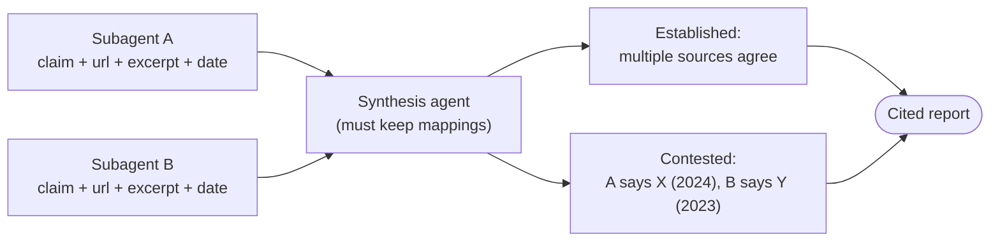

# Chapter 23 — Provenance & Conflicting Sources
{: .no_toc }

<details open markdown="block">
<summary>Contents</summary>
{: .text-delta }
1. TOC
{:toc}
</details>

---

## 🎯 Exam Snapshot

| Item | Detail |
|:--|:--|
| Domain | D5 (~15%). This is the **multi-agent research** scenario |
| The exam tests whether you can… | 1. Keep each **claim tied to its source** all the way through synthesis |
| | 2. Report **conflicting sources** without quietly picking one |
| | 3. Use **dates** so that "different years" isn't mistaken for "contradiction" |

---

## 🧠 Core Concepts

1. **Attribution is lost in summarization**: once findings are squeezed into prose, *"who said this?"* disappears.
2. **Claim–source mapping**: subagents return each claim with its **source URL or document, an excerpt, and a date**. Downstream agents **must keep** these fields.
3. **Conflicts are findings.** When credible sources disagree, **report both values with their sources**. Don't silently choose one or average them.
4. **Separate** the **well-established** findings (several agreeing sources) from the **contested** ones in the final report.
5. **Dates matter**: "12% (2022)" and "18% (2024)" may be a **trend**, not a contradiction. Require publication or collection dates.
6. **Match the presentation to the content**: tables for numbers, prose for narrative, lists for technical steps.
7. The Claude API's **Citations** feature can ground answers in supplied documents, returning the exact cited passages.

---

## 🔀 Diagram



---

## 📊 Handling Disagreement

| Situation | ❌ Wrong | ✅ Right |
|:--|:--|:--|
| Two credible sources give different statistics | Pick the more recent one silently | Show both with sources, and note the difference |
| Different years | Call it a contradiction | Present it as a time series or trend |
| One weak source vs several strong ones | Treat them as equal | Mark it as established, and note the outlier |
| No source supports a claim | Keep it because it "sounds right" | Remove it, or mark it as unverified |

## 📊 Claim Record Schema

| Field | Example |
|:--|:--|
| `claim` | "AI tools used by 41% of illustrators" |
| `source_url` / `document` | `https://example.org/survey-2024` |
| `excerpt` | "…41% of respondents reported…" |
| `date` | 2024-05 |
| `confidence` / `agreement` | `established` \| `contested` \| `single-source` |

---

## 💻 Implementation — Claims with Sources + Citations API

```python
import anthropic
client = anthropic.Anthropic()

# 1) Ground answers in YOUR documents with the Citations feature
resp = client.messages.create(
    model="claude-sonnet-5-5", max_tokens=1024,
    messages=[{"role": "user", "content": [
        {"type": "document",
         "source": {"type": "text", "media_type": "text/plain", "data": open("survey.txt").read()},
         "title": "Creative Industry Survey 2024",
         "citations": {"enabled": True}},
        {"type": "text", "text": "What share of illustrators use AI tools?"}]}])

for block in resp.content:
    if block.type == "text":
        print(block.text, [c.cited_text for c in (block.citations or [])])

# 2) Synthesis keeps the mappings and surfaces conflicts
def group_conflicts(claims: list[dict]) -> dict:
    by_topic = {}
    for c in claims:
        by_topic.setdefault(c["topic"], []).append(c)
    return {t: {"status": "contested" if len({c["value"] for c in cs}) > 1 else "established",
                "sources": [(c["value"], c["source_url"], c["date"]) for c in cs]}
            for t, cs in by_topic.items()}
```

1. Citations return the **exact passages** behind each statement.
2. The synthesis step **never drops** `source_url` or `date`.
3. Disagreeing values are labelled **contested**, with every source listed.

---

## ⚠️ Exam Traps

| Distractor | Why it's wrong | Correct choice |
|:--|:--|:--|
| The synthesizer writes polished prose with no per-claim sources | Attribution is lost | Keep claim–source mappings |
| Choose the more authoritative source when stats conflict | Hides a real disagreement | Report both, with attribution |
| Average the conflicting numbers | Invents a value no source gave | Show the range and its sources |
| Ignore the dates | A trend gets mislabelled as a contradiction | Require dates in the claim records |
| Fix the missing sources in the final report only | The loss happened earlier | Require structured sources from the **subagents** onwards |

---

## 🔁 Quick Recall

| Q | A |
|:--|:--|
| How does attribution survive synthesis? | Structured claim–source mappings |
| Two credible sources disagree? | Report both, with sources, as contested |
| Why require dates? | So time differences aren't treated as conflicts |
| Report structure? | Established vs contested findings |

---

## 🔗 References

1. [Citations — Claude Docs](https://docs.claude.com/en/docs/build-with-claude/citations)
2. [How we built our multi-agent research system](https://www.anthropic.com/engineering/multi-agent-research-system)
3. [Reduce hallucinations](https://docs.claude.com/en/docs/test-and-evaluate/strengthen-guardrails/reduce-hallucinations)
