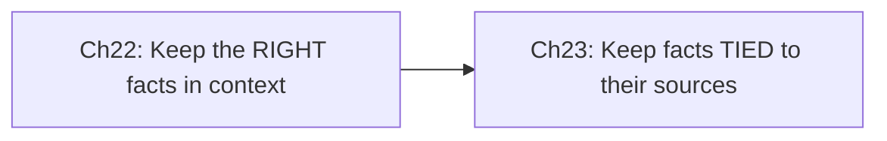

# Part F — Context Management & Reliability
{: .no_toc }

**Domain 5 · ~15% of the exam.** It shows up in long **support conversations** and **multi-agent research** synthesis.
{: .fs-5 }

| Ch | Title | Pages | You must be able to… |
|:--|:--|:--|:--|
| 22 | [Context Management](22-context-management.html) | 4 | Keep the critical facts exact across long conversations and large tool outputs |
| 23 | [Provenance & Conflicting Sources](23-provenance-sources.html) | 2 | Keep every claim tied to its source, and report disagreements honestly |

{: .key }
Context is a **limited budget**. Keep **exact facts** in a structured block, **trim** the noise, put **key information at the start or end**, and never let a summary **lose a source**.
