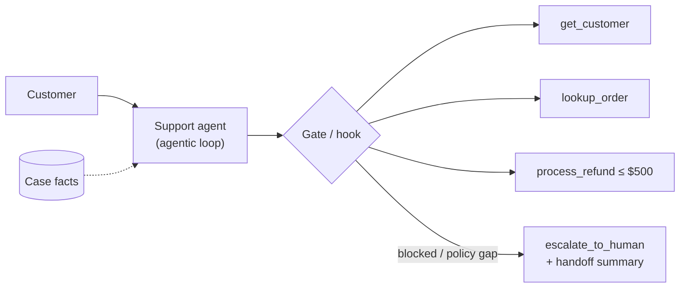
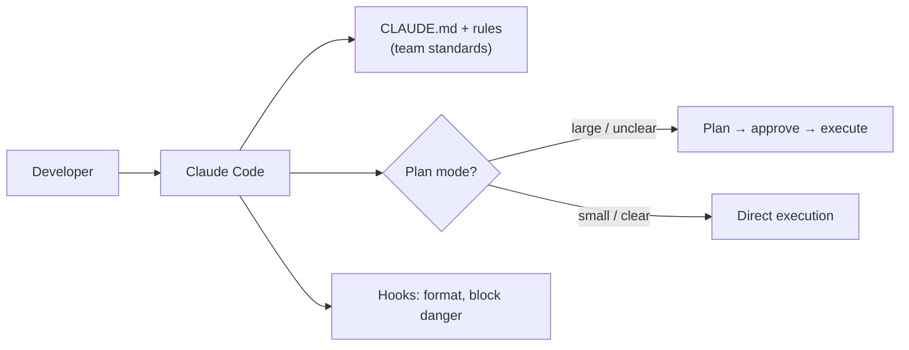
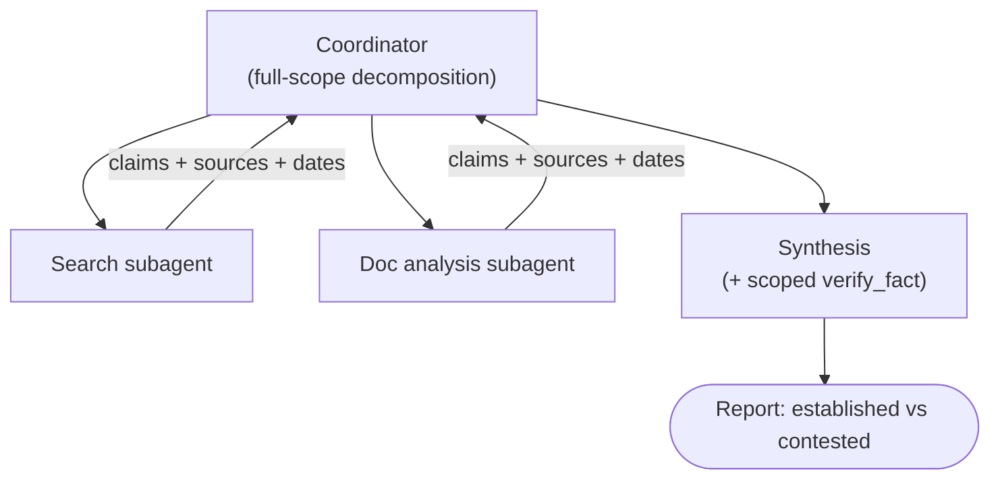
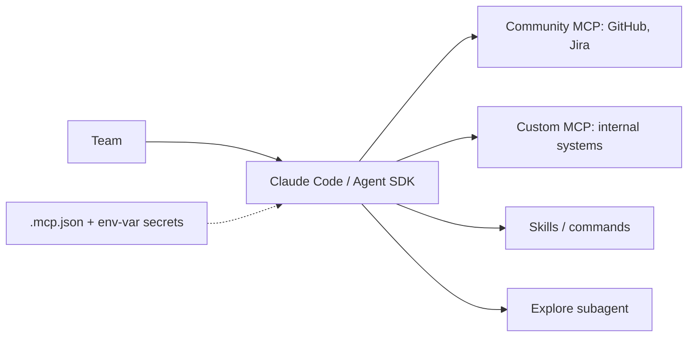
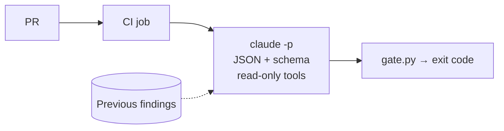
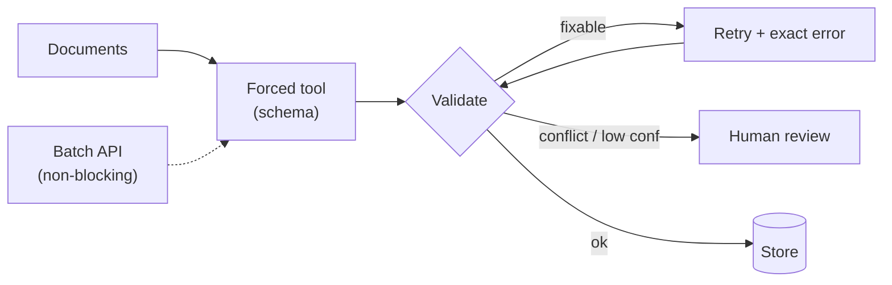

# Chapter 24 — The 6 Official Scenarios, Worked Through
{: .no_toc }

Contents

{: .text-delta }
1. TOC
{:toc}

---

## 🎯 How the Scenarios Work

1. Exam questions are grouped under **production scenarios**. Each one describes a system, and the questions ask for the **best design decision or fix**.
2. Each scenario draws on **several domains**. The table shows where to revise.

| # | Scenario | Main domains | Core chapters |
|:--|:--|:--|:--|
| 1 | Customer Support Resolution Agent | D1, D2, D5 | 5, 8, 9, 10, 22 |
| 2 | Code Generation with Claude Code | D3, D4 | 13, 14, 15, 16 |
| 3 | Multi-Agent Research System | D1, D5 | 6, 7, 23 |
| 4 | Developer Productivity with Claude | D2, D3 | 11, 12, 15 |
| 5 | Claude Code for Continuous Integration | D3, D4 | 17, 18, 19 |
| 6 | Structured Data Extraction | D4, D5 | 20, 21, 19 |

---

## 1️⃣ Customer Support Resolution Agent

| Decision point | Right answer | Ch |
|:--|:--|:--|
| The agent sometimes skips identity verification | **Programmatic prerequisite gate** | [8](../part-b/08-reliability-oversight.html) |
| Refunds over the limit | **PreToolUse hook** denies → escalate | [8](../part-b/08-reliability-oversight.html) |
| Wrong tool chosen | **Better tool descriptions** | [9](../part-c/09-tool-design.html) |
| Lookup times out | Structured error, **not an empty result** | [10](../part-c/10-tool-errors-results.html) |
| The customer asks for a human | **Escalate immediately** with a structured summary | [8](../part-b/08-reliability-oversight.html) |
| Long chat forgets the amounts | **Case facts block** | [22](../part-f/22-context-management.html) |

---

## 2️⃣ Code Generation with Claude Code

| Decision point | Right answer | Ch |
|:--|:--|:--|
| Teammates get different behaviour | Standards in the **project** CLAUDE.md, checked with `/memory` | [14](../part-d/14-claude-md-rules.html) |
| Conventions for files spread across many folders | `.claude/rules` + `paths:` globs | [14](../part-d/14-claude-md-rules.html) |
| A 45-file migration | **Plan mode** first | [13](../part-d/13-claude-code-architecture.html) |
| The output format keeps being wrong | **Concrete input/output examples** | [16](../part-d/16-sessions-workflows.html) |
| Must always happen (formatting) | **Hook** | [15](../part-d/15-skills-subagents-hooks.html) |

---

## 3️⃣ Multi-Agent Research System

| Decision point | Right answer | Ch |
|:--|:--|:--|
| The report misses subtopics | **Coordinator decomposition** too narrow | [6](../part-b/06-task-decomposition.html) |
| A subagent ignores the user's constraints | Pass the context **explicitly** in the Task prompt | [7](../part-b/07-multi-agent.html) |
| A subagent timeout | **Structured error + partial results** to the coordinator | [7](../part-b/07-multi-agent.html) |
| Slow, sequential spawning | **Several Task calls in one response** | [7](../part-b/07-multi-agent.html) |
| Sources lost in the report | **Claim–source mappings** from the subagents onwards | [23](../part-f/23-provenance-sources.html) |
| Sources disagree | Report **both, with attribution** | [23](../part-f/23-provenance-sources.html) |

---

## 4️⃣ Developer Productivity with Claude

| Decision point | Right answer | Ch |
|:--|:--|:--|
| Sharing MCP servers with the team | **`.mcp.json`** (project scope) | [12](../part-c/12-mcp-production.html) |
| Secrets in the configuration | `${ENV_VAR}` expansion | [12](../part-c/12-mcp-production.html) |
| A standard integration (GitHub) | A **community** server, not a custom one | [12](../part-c/12-mcp-production.html) |
| The agent uses Grep instead of an MCP tool | **Richer MCP tool description** | [11](../part-c/11-mcp-fundamentals.html) |
| A repeatable workflow | A **skill** (`context: fork` if it's verbose) | [15](../part-d/15-skills-subagents-hooks.html) |
| Exploration floods the context | **Explore subagent** | [13](../part-d/13-claude-code-architecture.html) |

---

## 5️⃣ Claude Code for Continuous Integration

| Decision point | Right answer | Ch |
|:--|:--|:--|
| The job hangs | **`-p`** print mode | [17](../part-d/17-ci-cd-review.html) |
| Parsing the verdict | `--output-format json` + `--json-schema` | [17](../part-d/17-ci-cd-review.html) |
| Missed bugs in self-review | An **independent** instance | [17](../part-d/17-ci-cd-review.html) |
| A large PR | **Per-file + cross-file passes** | [17](../part-d/17-ci-cd-review.html) |
| Duplicate comments | Include the **prior findings**, report new issues only | [17](../part-d/17-ci-cd-review.html) |
| Too many false positives | **Explicit criteria**, and turn off the noisy category | [18](../part-e/18-prompt-engineering.html) |

---

## 6️⃣ Structured Data Extraction

| Decision point | Right answer | Ch |
|:--|:--|:--|
| Guarantee the JSON structure | A **forced tool** / structured outputs | [20](../part-e/20-structured-extraction.html) |
| Invented values | **Nullable** fields, enum + "other" | [20](../part-e/20-structured-extraction.html) |
| Validation fails | Retry with the **doc + failed output + exact error** | [20](../part-e/20-structured-extraction.html) |
| The value isn't in the document | **Don't retry**: null or flag it | [20](../part-e/20-structured-extraction.html) |
| 50k documents overnight | **Batch API** + `custom_id` | [21](../part-e/21-batch-processing.html) |
| "97% accurate, so drop human review?" | Check **per document type** and sample first | [19](../part-e/19-prompt-evaluation.html) |
